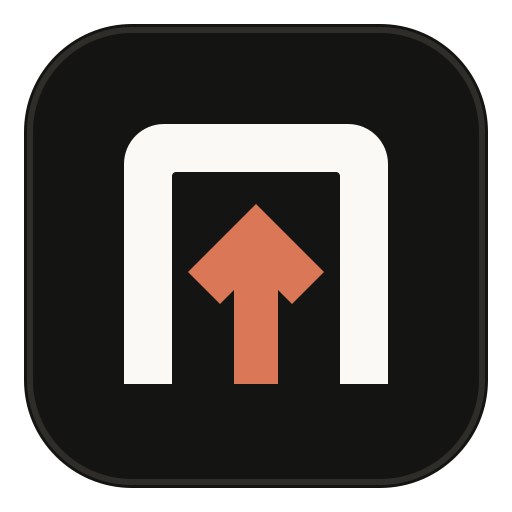
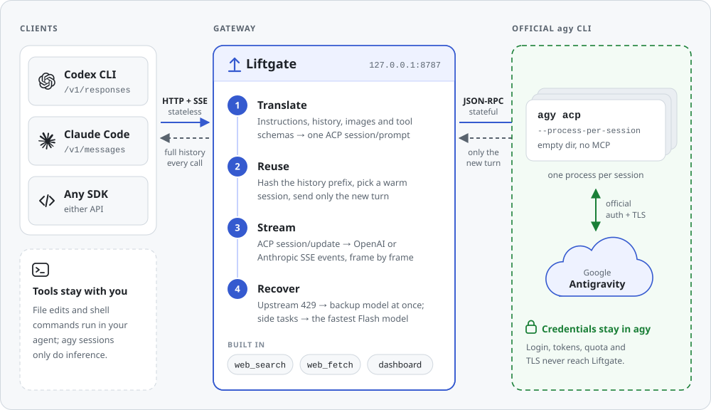

<p align="center">
  
</p>

<h1 align="center">Liftgate</h1>

<p align="center">
  <strong>Lift</strong>&nbsp;+&nbsp;<strong>gate</strong>way · <em>Lift Antigravity into every agent.</em>
</p>

<p align="center">
  <a href="https://github.com/acking-you/liftgate/releases/latest"></a>
  <a href="https://github.com/acking-you/liftgate/actions/workflows/syntax-check.yml"></a>
  <a href="https://www.rust-lang.org"></a>
  <a href="#license"></a>
</p>

<p align="center">
  <strong>English</strong> · <a href="README.zh-CN.md">中文</a>
</p>

> [!WARNING]
> Liftgate is pre-1.0: flags, endpoints and defaults can change without
> notice. Bug reports and feedback are welcome.

Liftgate puts Google Antigravity behind standard OpenAI Responses and Anthropic
Messages APIs on your machine. Keep using Codex CLI, Codex App, Claude Code,
Claude Desktop, OpenCode, Oh My Pi (`omp`), or your own SDK code unchanged —
Liftgate answers them locally and runs every turn exclusively through the
official `agy acp` interface.

Run it from the terminal with **`lg`** / **`liftgate`** (CLI + full-screen TUI +
embedded Web observability dashboard).

## Works with

<table>
  <tr>
    <td align="center" width="16%"><a href="docs/usage.md#codex-cli"><br><b>Codex CLI &amp; App</b></a><br><sub>OpenAI Responses</sub></td>
    <td align="center" width="16%"><a href="docs/usage.md#claude-code"><br><b>Claude Code &amp; Desktop</b></a><br><sub>Anthropic Messages</sub></td>
    <td align="center" width="16%"><a href="docs/usage.md#opencode"><br><b>OpenCode</b></a><br><sub><code>lg oc</code> · Code Mode</sub></td>
    <td align="center" width="16%"><a href="docs/usage.md#oh-my-pi-omp"><br><b>Oh My Pi</b></a><br><sub><code>lg omp</code> · Code Mode</sub></td>
    <td align="center" width="18%"><a href="docs/api.md#openai-responses"><br><b>OpenAI SDKs</b></a><br><sub><code>/v1/responses</code></sub></td>
    <td align="center" width="18%"><a href="docs/api.md#anthropic-messages"><br><b>Anthropic SDKs</b></a><br><sub><code>/v1/messages</code></sub></td>
  </tr>
</table>

Any other harness that speaks either API connects the same way
([API](docs/api.md)).

## Install

Install prebuilt `lg` and `liftgate` binaries (with the Web dashboard embedded
and `SHA256SUMS` verified fail-closed) in one command:

**macOS / Linux / FreeBSD**

```bash
curl -fsSL https://raw.githubusercontent.com/acking-you/liftgate/main/scripts/install.sh | sh
```

**Windows (PowerShell)**

```powershell
irm https://raw.githubusercontent.com/acking-you/liftgate/main/scripts/install.ps1 | iex
```

`LIFTGATE_VERSION=v0.2.5` pins a tag, `LIFTGATE_BIN_DIR` sets the install
directory, and `LIFTGATE_NO_MODIFY_PATH=1` skips updating `PATH`. Once
installed, run `lg upgrade` anytime to update in place.

<details>
<summary>Other CLI install methods (<code>cargo binstall</code>, GitHub Releases, source build)</summary>

```bash
# Prebuilt archive via cargo-binstall
cargo binstall liftgate

# Build from a local checkout (Rust 1.100.0; embeds Web UI automatically when Bun is installed)
cargo install --path crates/liftgate --locked
```

Prebuilt 17-target archives (static `musl` Linux, `glibc` Linux, macOS
ARM64/Intel, Windows x64/ARM64/x86, FreeBSD) are also available directly on the
[latest CLI release](https://github.com/acking-you/liftgate/releases/latest).

</details>

## Quick start

Once **`lg`** (identical to `liftgate`) is installed, install the official
`agy` CLI if needed, sign in, and launch your agent:

```bash
# 1. One-time Antigravity CLI setup & sign-in
lg agy install                          # download & SHA-512-verify official `agy` CLI
lg proxy 7890                           # optional: force proxy into `agy` (`lg proxy off` restores direct default)
lg agy login                            # sign in to Google Antigravity interactively via `agy acp --login`

# 2. Launch agents with zero config pollution (auto-starts background gateway)
lg                                      # interactive command center in your terminal
lg cx                                   # launch Codex CLI in current dir (0 side effects on exit)
lg cx resume                            # browse & resume Codex sessions (`--last`, `--all`, `fork`, `agents`)
lg cxa                                  # launch Codex App across Win/macOS/Linux (isolated profile)
lg cc                                   # launch Claude Code in current dir (0 side effects on exit)
lg cc -r                                # browse & resume Claude sessions (`lg cc resume`, `-c`, `fork`, `agents`)
lg cd                                   # launch Claude Desktop across Win/macOS/Linux (auto-restores on exit)
lg oc                                   # launch OpenCode in current dir (0 side effects on exit)
lg oc -c                                # continue latest OpenCode session (`-s <ID>`, `--full-code-mode`, `run`)
lg omp                                  # launch Oh My Pi (`omp`) in current dir (0 side effects on exit)
lg omp -c                               # continue latest `omp` session (`-r`, `--full-code-mode`, `models`)
```

Monitor live traffic, hot-switch models, or sync persistent configs from anywhere:

```bash
lg agy                   # inspect `agy` version, login status, forced proxy & idle auto-update
lg remote 10.0.0.8:8787  # route `lg cx`/`cc`/`oc`/`omp`/`top` to a remote Liftgate host (`lg remote local` resets)
lg top                   # full-screen real-time terminal dashboard (turns, pool, models, logs)
lg m -i                  # interactively filter & hot-switch default Antigravity model
lg up --open             # start background gateway + open embedded Web dashboard
lg st                    # health, PID, session pool, token metrics & active turns
lg cfg -g                # losslessly merge ~/.claude, ~/.codex, ~/.config/opencode & ~/.omp (--uninstall to remove)
lg upgrade               # check GitHub Releases (--check) & self-upgrade `lg` + `liftgate`
lg down                  # gracefully stop the background gateway
```

Running straight from a source checkout via `./run-gateway.{sh,cmd}` works as
well. Full command reference and SDK examples:
[usage guide](docs/usage.md).

## What it does

- **Official interface only** — talks to Antigravity only through `agy acp`,
  the Agent Client Protocol the CLI ships for editors. Login, tokens, quota and
  TLS stay inside `agy` ([why ACP](docs/architecture.md#why-acp)).
- **Built-in `agy` setup, proxy & idle auto-update** — install `agy` with
  `lg agy install` (SHA-512 verified), sign in with `lg agy login`, optionally
  force an outbound proxy into `agy` with `lg proxy <port|url>` (default:
  direct, no proxy), and keep `agy` automatically updated while the gateway is
  idle (`lg agy auto-update`).
- **Two standard APIs** — OpenAI Responses and Anthropic Messages, streamed,
  with tool calls, thinking, images and token counting ([API](docs/api.md)).
- **Your agent keeps the tools** — ACP sessions run in an empty directory with
  no host workspace access, so file edits and shell commands stay in Codex,
  Claude Code, OpenCode, or Oh My Pi (`omp`); web search and an SSRF-safe web
  fetch run in the gateway
  ([inference-only sessions](docs/architecture.md#inference-only-sessions)).
- **Warm sessions** — each request's history is matched to a pooled ACP
  session and only the new turn is sent ([session reuse](docs/architecture.md#session-reuse)).
- **Verified context windows** — Codex, Claude Code, OpenCode, and Oh My Pi compact cleanly within
  empirically verified ACP session windows (`500k / 425k` for Gemini, safely
  below Antigravity's `524,288`-token internal compaction threshold) with
  single-turn prompts and zero synthetic replay turns ([context policy](docs/usage.md#context-windows)).
- **Live model catalog** — `/v1/models` and a Codex catalog list every model
  your account can use, so `/model` pickers show Antigravity models
  ([Codex setup](docs/usage.md#codex-cli)).
- **No silent downgrade & Flash fast lanes** — upstream `429` rate limits surface
  immediately on the exact model you asked for without silent fallback, while
  titles, recaps and Auto Mode classifiers use the fastest
  Flash model without touching your main session ([model routing](docs/architecture.md#model-routing)).
- **Web & terminal dashboards** — inspect live turns, evict pooled sessions,
  switch models and tail `agy` logs either in the browser
  (`http://127.0.0.1:8787/`) or right inside your terminal with `lg top`
  ([dashboard](docs/usage.md#dashboard)).

## How it works

<picture>
  <source media="(prefers-color-scheme: dark)" srcset="assets/readme/how-it-works-dark.svg">
  
</picture>

Standard LLM APIs are stateless: every request carries the whole
conversation. ACP is a stateful editor session. Liftgate keeps one
`agy acp` process per session, forwards only what is new, and streams ACP
updates back as OpenAI or Anthropic events. See [architecture](docs/architecture.md).

## Documentation

| | |
| --- | --- |
| **Use** | [Usage guide](docs/usage.md) · [Remote gateway](docs/remote.md) · [Codex CLI](docs/usage.md#codex-cli) · [Claude Code](docs/usage.md#claude-code) · [OpenCode](docs/usage.md#opencode) · [Oh My Pi](docs/usage.md#oh-my-pi-omp) · [Dashboard](docs/usage.md#dashboard) · [Flags](docs/usage.md#flags-and-environment) |
| **Reference** | [API](docs/api.md) · [Architecture](docs/architecture.md) |
| **Project** | [Changelog](CHANGELOG.md) · [Rust standard](docs/2026-11-09-RUST.md) · [AGENTS.md](AGENTS.md) |

All pages: [docs index](docs/README.md).

## Contributing

Build, lint and test commands, architecture rules and the Rust standard every
change follows are in [AGENTS.md](AGENTS.md); note user-visible changes in
[CHANGELOG.md](CHANGELOG.md).

## License

Either [Apache License 2.0](LICENSE-APACHE) or [MIT](LICENSE-MIT), at your
option. The client marks in `assets/readme/` come from Simple Icons (CC0) and
belong to their owners ([notice](assets/readme/NOTICE.txt)).
