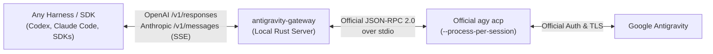

# antigravity-gateway

[](https://github.com/acking-you/antigravity-gateway/actions/workflows/syntax-check.yml)
[](#license)

English | [简体中文](README_zh.md)

Expose Google Antigravity as a standard **OpenAI (`/v1/responses`)** and **Anthropic (`/v1/messages`)** API gateway for **Codex CLI**, **Claude Code**, and any custom agent harness.

---

## How It Works & Why It Is Safe

### Why This Is the Safest, Officially Supported Mode

Many third-party proxy tools rely on scraping local OAuth credentials, patching closed binaries, or spoofing private internal headers—approaches that risk credential leakage, break easily, and violate terms of service.

`antigravity-gateway` uses **only the official Agent Client Protocol (`agy acp`)** built into the Antigravity CLI—the exact JSON-RPC 2.0 `stdio` interface officially supported for external IDEs and editors:

- **Zero Credential Scraping**: Authentication (`agy acp --login`), token refresh, quota accounting, and upstream TLS stay **100% inside the official `agy` binary**.
- **Zero Reverse Engineering**: No binary modification, no MITM certificate injection, and no private endpoint spoofing.

### How ACP Simulates Standard LLM APIs



Standard LLM APIs are stateless HTTP/SSE endpoints, whereas ACP is a stateful editor-agent session protocol. `antigravity-gateway` bridges the two cleanly:

1. **Pure Inference Isolation**: Spawns `agy acp --process-per-session` workers in an isolated empty directory with no external MCP servers (`mcpServers: []`), turning ACP into a pure reasoning/inference backend while letting your client harness (`codex`, `claude`, etc.) own all local file edits and shell execution.
2. **Prompt & Tool Schema Translation**: Normalizes OpenAI `/v1/responses` and Anthropic `/v1/messages` payloads (system/developer instructions, multi-turn history, images, and client JSON tool definitions) into structured ACP `session/prompt` requests, while bridging server-side `web_search` and SSRF-safe `web_fetch` natively.
3. **Stateful Prefix-Hash Reuse (`SessionPool`)**: Although HTTP clients resend the full conversation history on every turn, the gateway hashes canonical message prefixes to match requests against warm ACP sessions in an LRU pool—forwarding **only the new incremental turn delta** for low latency.
4. **Real-Time SSE Stream Mapping**: Translates ACP `session/update` notifications (`agent_thought_chunk`, `agent_message_chunk`, and structured tool calls) frame-by-frame into standard OpenAI Responses or Anthropic Messages SSE events, with instant `429` capacity failover.

---

## Prerequisites

1. **Antigravity CLI (`agy`)** installed and signed in:
   ```bash
   agy acp --login
   ```
2. **Rust `1.85+`** (Edition 2024).
3. *(Optional)* **Bun** — if installed, the build script also compiles the embedded web telemetry dashboard (`web/dist`) served at `http://127.0.0.1:8787/`.

---

## Quick Start: One-Click Release Build & Run

Use `run-gateway` to compile `agy-acp-gateway` in `--release` mode (plus `web/dist` if Bun is installed) and start the local API server on `http://127.0.0.1:8787`:

### Windows (`CMD` or `PowerShell`)

```powershell
# Build release and run in foreground (Ctrl+C to stop)
.\run-gateway.cmd

# Or run detached in the background / stop background daemon
.\run-gateway.cmd -Daemon
.\run-gateway.cmd -Stop

# Optional: pass custom listen address, default model, or local API key
.\run-gateway.cmd --listen 127.0.0.1:8787 --default-model gemini-4-carbon-high --api-key local-agy
```

### Linux & macOS

```bash
chmod +x ./run-gateway.sh

# Build release and run in foreground (Ctrl+C to stop)
./run-gateway.sh

# Or run detached in the background / stop background daemon
./run-gateway.sh --daemon
./run-gateway.sh --stop

# Optional: pass custom listen address, default model, or local API key
./run-gateway.sh --listen 127.0.0.1:8787 --default-model gemini-4-carbon-high --api-key local-agy
```

> [!TIP]
> Want to launch Claude Code or Codex temporarily **without** editing `~/.codex/config.toml` or global environment variables? Use the all-in-one session wrapper instead:
> - **Windows**: `.\start-agy.cmd` (Claude Code) or `.\start-agy.cmd -Codex` (Codex CLI)
> - **Linux / macOS**: `./start-agy.sh` (Claude Code) or `./start-agy.sh --codex` (Codex CLI)

---

## Manual Integration with Codex CLI & Claude Code

Once the gateway is running (`http://127.0.0.1:8787`), you can point `codex` or `claude` to it directly. You can inspect all live model IDs anytime via `curl http://127.0.0.1:8787/v1/models`.

### 1. OpenAI Codex CLI (`codex`)

**Step 1 *(Optional, Recommended)* — Export the live Antigravity model catalog** so `/model` inside Codex lists every Antigravity model (`gemini-4-carbon-high`, `claude-opus-5-5-high`, etc.) with accurate context windows:

```bash
# Linux / macOS
mkdir -p ~/.codex
curl -fsS "http://127.0.0.1:8787/v1/codex-models?default_model=gemini-4-carbon-high" -o ~/.codex/agy-models.json
```

```powershell
# Windows (PowerShell)
New-Item -ItemType Directory -Force -Path "$HOME\.codex" | Out-Null
Invoke-WebRequest "http://127.0.0.1:8787/v1/codex-models?default_model=gemini-4-carbon-high" -OutFile "$HOME\.codex\agy-models.json"
```

**Step 2 — Add the gateway provider to `~/.codex/config.toml`**:

```toml
model = "gemini-4-carbon-high"
model_provider = "agy"
# Optional: replace `/Users/you` (or `C:/Users/you` on Windows) with your home path if you ran Step 1
model_catalog_json = "/Users/you/.codex/agy-models.json"
web_search = "live"
model_context_window = 1000000
model_auto_compact_token_limit = 850000

[model_providers.agy]
name = "Antigravity ACP Gateway"
base_url = "http://127.0.0.1:8787/v1"
wire_api = "responses"
# Uncomment if you started the gateway with `--api-key <key>` (then set AGY_GATEWAY_API_KEY in your shell):
# env_key = "AGY_GATEWAY_API_KEY"
```

**Step 3 — Run `codex`**:

```bash
# If your machine uses an HTTP/HTTPS proxy, bypass loopback first:
export NO_PROXY="127.0.0.1,localhost,::1"
codex
```

---

### 2. Claude Code (`claude`)

#### Option A: Via Environment Variables (Current Shell)

```bash
# Linux / macOS
export ANTHROPIC_BASE_URL="http://127.0.0.1:8787"
export ANTHROPIC_AUTH_TOKEN="local-agy"
export ANTHROPIC_MODEL="gemini-4-carbon-high"
export ANTHROPIC_SMALL_FAST_MODEL="gemini-3.8-flash-low"
export CLAUDE_CODE_MAX_CONTEXT_TOKENS="1000000"
export NO_PROXY="127.0.0.1,localhost,::1"
claude
```

```powershell
# Windows (PowerShell)
$env:ANTHROPIC_BASE_URL = "http://127.0.0.1:8787"
$env:ANTHROPIC_AUTH_TOKEN = "local-agy"
$env:ANTHROPIC_MODEL = "gemini-4-carbon-high"
$env:ANTHROPIC_SMALL_FAST_MODEL = "gemini-3.8-flash-low"
$env:CLAUDE_CODE_MAX_CONTEXT_TOKENS = "1000000"
$env:NO_PROXY = "127.0.0.1,localhost,::1"
claude
```

*(Note: If you started the gateway without `--api-key`, any non-empty `ANTHROPIC_AUTH_TOKEN` such as `"local-agy"` satisfies Claude Code's local auth check; if you passed `--api-key <key>`, set `ANTHROPIC_AUTH_TOKEN` to `<key>`.)*

#### Option B: Via `~/.claude/settings.json` (or `.claude/settings.local.json`)

```json
{
  "model": "gemini-4-carbon-high",
  "env": {
    "ANTHROPIC_BASE_URL": "http://127.0.0.1:8787",
    "ANTHROPIC_AUTH_TOKEN": "local-agy",
    "ANTHROPIC_MODEL": "gemini-4-carbon-high",
    "ANTHROPIC_SMALL_FAST_MODEL": "gemini-3.8-flash-low",
    "CLAUDE_CODE_MAX_CONTEXT_TOKENS": "1000000",
    "NO_PROXY": "127.0.0.1,localhost,::1"
  }
}
```

---

### 3. Standard OpenAI / Anthropic SDKs

- **OpenAI Responses SDK**: `base_url = "http://127.0.0.1:8787/v1"` (`POST /v1/responses`, `GET /v1/models`)
- **Anthropic Messages SDK**: `base_url = "http://127.0.0.1:8787"` (`POST /v1/messages`, `POST /v1/messages/count_tokens`)

---

## Project Layout & Verification

```text
├── crates/
│   ├── agy-gateway-types/    # Pure protocol, wire & config types (zero async/HTTP/I/O deps)
│   ├── agy-gateway-server/   # Axum router, ACP stdio supervisor, SessionPool, web_fetch, telemetry
│   └── agy-acp-gateway/      # CLI entrypoint & embedded static UI server
├── web/                      # Companion real-time telemetry console (Bun + Vite + React + shadcn/ui)
├── docs/2026-11-09-RUST.md   # Workspace Rust engineering standard
├── run-gateway.{ps1,cmd,sh}  # One-click release build & gateway server startup scripts
└── start-agy.{ps1,cmd,sh}    # Optional all-in-one harness wrapper (scoped Claude / Codex launcher)
```

See [`AGENTS.md`](AGENTS.md) and [`docs/2026-11-09-RUST.md`](docs/2026-11-09-RUST.md) for engineering guidelines.

```bash
cargo fmt --all -- --check
cargo clippy --workspace --all-targets --all-features --locked -- -D warnings
cargo test --workspace --all-features --locked
RUSTDOCFLAGS="-D warnings" cargo doc --workspace --no-deps --locked
```

## License

Licensed under either of [Apache License, Version 2.0](LICENSE-APACHE) or [MIT License](LICENSE-MIT) at your option.
