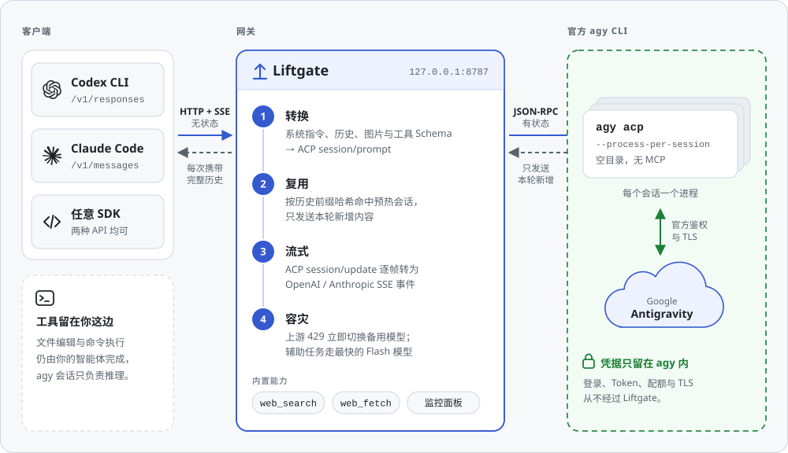

<h1 align="center">Liftgate</h1>

<p align="center">
  <strong>Lift</strong>&nbsp;+&nbsp;<strong>gate</strong>way · <em>把 Antigravity 托举进每一个智能体。</em>
</p>

<p align="center">
  <a href="https://github.com/acking-you/liftgate/releases"></a>
  <a href="https://github.com/acking-you/liftgate/actions/workflows/syntax-check.yml"></a>
  <a href="https://www.rust-lang.org"></a>
  <a href="#许可证"></a>
</p>

<p align="center">
  <a href="README.md">English</a> · <strong>中文</strong>
</p>

> [!WARNING]
> Liftgate 尚未发布 1.0：参数、接口和默认值都可能不经通知而变化。欢迎反馈缺陷和意见。

Liftgate 把 Google Antigravity 接到 OpenAI 与 Anthropic 的标准 API 后面。Codex CLI、Claude Code 或你自己的 SDK 代码照原样使用；Liftgate 在本机应答它们，每一轮对话都交给官方 `agy` CLI 执行。

## 支持的客户端

<table>
  <tr>
    <td align="center" width="25%"><a href="docs/usage.zh-CN.md#codex-cli"><br><b>Codex CLI / App</b></a><br><sub>OpenAI Responses</sub></td>
    <td align="center" width="25%"><a href="docs/usage.zh-CN.md#claude-code"><br><b>Claude Code / Desktop</b></a><br><sub>Anthropic Messages</sub></td>
    <td align="center" width="25%"><a href="docs/api.md#openai-responses"><br><b>OpenAI SDK</b></a><br><sub><code>/v1/responses</code></sub></td>
    <td align="center" width="25%"><a href="docs/api.md#anthropic-messages"><br><b>Anthropic SDK</b></a><br><sub><code>/v1/messages</code></sub></td>
  </tr>
</table>

其它讲这两种 API 的 Harness 用同样方式接入（[API](docs/api.md)）。

## 能做什么

- **只走官方接口**：只通过 `agy acp`（CLI 为编辑器提供的 Agent Client Protocol）与 Antigravity 通信，登录、Token、配额与 TLS 都留在 `agy` 内部（[为什么是 ACP](docs/architecture.md#why-acp)）。
- **内置 `agy` 一键安装、代理注入与空闲自动更新**：缺失 `agy` 时用 `lg agy install` 跨平台自动下载并做 SHA-512 校验，用 `lg agy login` 完成交互登录；默认**不设置任何代理**，需要时一条 `lg proxy <端口|URL>` 即可在 `agy` 启动时强制注入代理；网关运行期间默认在空闲时自动检测并无感热更新 `agy`（可通过 `lg agy auto-update` 随时开关）。
- **两套标准 API**：OpenAI Responses 与 Anthropic Messages，支持流式输出、工具调用、思考过程、图片与 Token 计数（[API](docs/api.md)）。
- **工具留在你的智能体里**：ACP 会话运行在空目录且不挂任何 MCP 服务，文件编辑与命令执行仍由 Codex 或 Claude Code 完成；联网搜索与防 SSRF 的网页抓取由网关处理（[纯推理会话](docs/architecture.md#inference-only-sessions)）。
- **会话预热复用**：按每次请求的历史匹配池中已预热的 ACP 会话，只发送本轮新增内容（[会话复用](docs/architecture.md#session-reuse)）。
- **稳妥的上下文默认配置**：Codex 与 Claude Code 按模型窗口提前压缩；Flash 历史分块预灌仅作为显式实验选项，不能绕过上游自动压缩（[上下文策略](docs/usage.zh-CN.md#上下文窗口与超长上下文选项)）。
- **实时模型目录**：`/v1/models` 与 Codex 模型目录列出账号下全部可用模型，`/model` 菜单直接显示 Antigravity 模型（[接入 Codex](docs/usage.zh-CN.md#codex-cli)）。
- **拒绝静默降级与 Flash 快车道**：上游 `429` 限流立即返回，绝不暗中偷换模型；标题、摘要与 Auto Mode 分类走独立的 Flash 会话，不打扰主会话（[模型路由](docs/architecture.md#model-routing)）。
- **Web 与终端双监控面板**：既可在浏览器 `http://127.0.0.1:8787/` 打开内嵌 React 面板，也可直接在终端运行 `lg top` 全屏实时查看对话流、驱逐空闲会话、热切换模型与追踪日志（[监控面板](docs/usage.zh-CN.md#监控面板)）。

## 工作原理

<picture>
  <source media="(prefers-color-scheme: dark)" srcset="assets/readme/how-it-works-dark.zh-CN.svg">
  
</picture>

标准 LLM API 是无状态的：每次请求都携带完整对话。ACP 则是有状态的编辑器会话。Liftgate 为每个会话保持一个 `agy acp` 进程，只转发新增内容，再把 ACP 更新流式转换成 OpenAI 或 Anthropic 事件。详见[架构](docs/architecture.md)。

## 快速开始

从 [GitHub Releases](https://github.com/acking-you/liftgate/releases) 下载对应平台发行包（或通过 `cargo binstall liftgate` / `cargo install` 安装），即可直接用短命令 **`lg`**（与 `liftgate` 完全等价）一键完成 `agy` 安装、可选代理设置与登录：

```bash
cargo install --path crates/liftgate --locked  # 同时安装 `lg` 与 `liftgate`（装有 Bun 时自动内嵌 Web 面板）

lg agy install                          # 若本机尚未安装 `agy`，跨平台下载官方包并做 SHA-512 校验安装
lg proxy 7890                           # 可选：为 `agy` 强制指定代理（默认不设任何代理，`lg proxy off` 关闭）
lg agy login                            # 通过官方 `agy acp --login` 交互式登录 Google Antigravity

lg                                      # 在终端直接打开交互式控制中心（快捷键一键启动）
lg cx                                   # 在当前目录直接启动 Codex CLI（退出后 0 副作用）
lg cx resume                            # 浏览并恢复 Codex 会话（支持 `--last`、`--all`、`fork`、`agents` 等原生命令）
lg cxa                                  # 跨 Win/macOS/Linux 启动 Codex App（完全 0 污染）
lg cc                                   # 或在当前目录直接启动 Claude Code（退出后 0 副作用）
lg cc -r                                # 浏览并恢复 Claude 会话（支持 `lg cc resume`、`-c`、`fork`、`agents` 等原生命令）
lg cd                                   # 或跨 Win/macOS/Linux 启动 Claude Desktop（退出自动还原）
```

在任意目录下打开终端 TUI 监控、交互式切换模型，或同步项目级与全局客户端配置：

```bash
lg agy                   # 查看 `agy` 是否存在、版本、登录状态、强制代理与空闲自动更新策略
lg top                   # 打开全屏实时终端仪表盘（实时请求、会话池管理、模型切换、日志）
lg m -i                  # 交互式搜索并热切换默认 Antigravity 模型
lg up --open             # 后台启动网关服务并打开内嵌 Web 监控面板
lg st                    # 查看健康状态、PID、会话池、Token 统计与进行中轮次
lg cfg -g                # 无损合并 ~/.claude 与 ~/.codex 全局配置（--uninstall 卸载）
lg upgrade               # 检查 GitHub Releases（--check）并自动校验升级 `lg` + `liftgate`
lg down                  # 优雅停止后台网关服务
```

在源码仓库中继续使用 `./run-gateway.{sh,cmd}` 与 `./start-agy.{sh,cmd}` 同样完全兼容。完整子命令说明、参数列表与 SDK 接入方式见[使用指南](docs/usage.zh-CN.md)。

## 文档

| | |
| --- | --- |
| **使用** | [使用指南](docs/usage.zh-CN.md) · [Codex CLI](docs/usage.zh-CN.md#codex-cli) · [Claude Code](docs/usage.zh-CN.md#claude-code) · [监控面板](docs/usage.zh-CN.md#监控面板) · [参数](docs/usage.zh-CN.md#参数与环境变量) |
| **参考** | [API](docs/api.md) · [架构](docs/architecture.md) |
| **项目** | [更新日志](CHANGELOG.md) · [Rust 规范](docs/2026-11-09-RUST.md) · [AGENTS.md](AGENTS.md) |

全部文档：[文档索引](docs/README.md)（除使用指南外多为英文）。

## 参与贡献

构建、检查与测试命令、架构约束以及每次改动都要遵循的 Rust 规范见 [AGENTS.md](AGENTS.md)；用户可见的改动请记录到 [CHANGELOG.md](CHANGELOG.md)。

## 许可证

[Apache License 2.0](LICENSE-APACHE) 或 [MIT](LICENSE-MIT) 双协议，任选其一。`assets/readme/` 中的客户端图标来自 Simple Icons（CC0），商标归各自所有者（[说明](assets/readme/NOTICE.txt)）。
