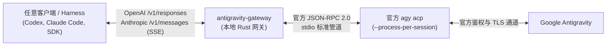

# antigravity-gateway

[](https://github.com/acking-you/antigravity-gateway/actions/workflows/syntax-check.yml)
[](#开源协议)

[English](README.md) | 简体中文

将 Google Antigravity 正规地暴露为标准的 **OpenAI（`/v1/responses`）** 与 **Anthropic（`/v1/messages`）** 本地 API 网关，无缝驱动 **Codex CLI**、**Claude Code** 及任意 Agent Harness。

---

## 核心原理：ACP 如何模拟标准 API（为什么这是目前最安全、官方完全支持的模式）

### 为什么这是目前最安全、官方原生支持的方案？

常见的非官方反代方案往往依赖提取本地磁盘/钥匙串中的 OAuth Token、逆向修改闭源二进制、或伪造私有请求头与抓包劫持——这类做法不仅极易失效、存在凭据泄露风险，更可能违反服务条款导致账号风控。

`antigravity-gateway` 采用 **100% 官方受支持的正规路径**：Google 官方 `agy` CLI 原生内置了面向外部 IDE/编辑器的标准 **Agent Client Protocol（`agy acp`）** `stdio` JSON-RPC 2.0 通信接口。本网关仅作为标准 ACP 客户端宿主与官方 `agy` 子进程对话：

- **零凭据触碰**：账号登录（`agy acp --login`）、Token 刷新、配额管理与上游 TLS 加密通信 **100% 保留在官方 `agy` 进程内部完成**，网关从不读取任何私密凭据。
- **零逆向与零侵入**：不修改任何二进制文件、不注入证书、不伪造私有协议接口。

### ACP 协议是如何模拟标准无状态 LLM API 的？



标准大模型 API 是**无状态的 HTTP/SSE 请求**（每次携带完整历史与工具 Schema），而 ACP 是**有状态的编辑器会话协议**。网关通过以下四步在本地完成透明转换与模拟：

1. **纯推理沙箱隔离**：网关以 `--process-per-session` 模式在受控的空工作目录中拉起官方 `agy acp` 进程，并显式传入 `mcpServers: []` 剥离编辑器副作用，使 ACP 退化为纯粹的模型推理引擎；本地文件读写与命令执行完全交还给上层 Harness（如 Codex 或 Claude Code）自行控制。
2. **协议与工具 Schema 双向桥接**：将 OpenAI `/v1/responses` 或 Anthropic `/v1/messages` 的系统指令、多轮对话、图片以及客户端工具定义（`function` / `custom` / `tool_use`）归一化为结构化的 ACP `session/prompt` 请求，同时在网关侧原生闭环处理 `web_search` 与防 SSRF 的 `web_fetch` 网页抓取。
3. **前缀哈希会话复用（`SessionPool`）**：虽然 HTTP 客户端每轮都会重发全量历史消息，网关会对归一化后的对话前缀计算确定性哈希，自动匹配 LRU 池中已预热的 ACP 会话，**仅向 `agy acp` 追加发送本轮新增消息或工具返回（Delta）**，大幅降低首字延迟与上下文开销。
4. **实时流式 SSE 映射与容灾**：实时监听 ACP 的 `session/update` 流事件（思考片段 `agent_thought_chunk`、正文片段 `agent_message_chunk` 及工具调用），逐帧转换为标准的 OpenAI Responses 或 Anthropic Messages SSE 事件流，并在检测到 `429` 容量耗尽时毫秒级自动切换备用模型。

---

## 环境准备

1. 已安装 **Antigravity CLI（`agy`）** 并完成官方登录：
   ```bash
   agy acp --login
   ```
2. 已安装 **Rust `1.85+`**（Edition 2024）。
3. *（可选）* **Bun**：若本机安装了 Bun，一键脚本会自动编译前端监控面板（`web/dist`）并直接挂载在网关根路径 `http://127.0.0.1:8787/` 下；未安装也不影响任何 API 功能。

---

## 快速开始：一键编译 Release 并启动网关

项目提供了开箱即用的 `run-gateway` 脚本，自动完成前端静态资源构建（若安装了 Bun）、`cargo build --release --locked` 编译优化版二进制，并启动本地网关服务（默认监听 `http://127.0.0.1:8787`）：

### Windows（`CMD` 或 `PowerShell`）

```powershell
# 一键编译 Release 并前台启动网关（按 Ctrl+C 优雅停止）
.\run-gateway.cmd

# 或者：后台守护模式启动 / 停止后台网关
.\run-gateway.cmd -Daemon
.\run-gateway.cmd -Stop

# 可选：透传自定义监听地址、默认模型或本地 API Key
.\run-gateway.cmd --listen 127.0.0.1:8787 --default-model gemini-4-carbon-high --api-key local-agy
```

### Linux 与 macOS

```bash
chmod +x ./run-gateway.sh

# 一键编译 Release 并前台启动网关（按 Ctrl+C 优雅停止）
./run-gateway.sh

# 或者：后台守护模式启动 / 停止后台网关
./run-gateway.sh --daemon
./run-gateway.sh --stop

# 可选：透传自定义监听地址、默认模型或本地 API Key
./run-gateway.sh --listen 127.0.0.1:8787 --default-model gemini-4-carbon-high --api-key local-agy
```

> [!TIP]
> 如果你不想修改全局配置文件，希望**一键临时拉起网关并直接进入已配好全量模型列表的 Claude Code 或 Codex**（退出后自动还原终端环境），也可以直接使用内置的会话启动器：
> - **Windows**：`.\start-agy.cmd`（启动 Claude Code）或 `.\start-agy.cmd -Codex`（启动 Codex CLI）
> - **Linux / macOS**：`./start-agy.sh`（启动 Claude Code）或 `./start-agy.sh --codex`（启动 Codex CLI）

---

## 手动接入指南：Codex CLI 与 Claude Code

当网关通过 `run-gateway` 在 `http://127.0.0.1:8787` 启动后，你可以按以下方式将 `codex` 或 `claude` 手动接入网关。随时可通过 `curl http://127.0.0.1:8787/v1/models` 查看当前账号下所有可用的实时模型 ID。

### 1. 手动接入 OpenAI Codex CLI（`codex`）

**第一步（可选，强烈推荐）— 导出 Antigravity 实时模型目录**，让 Codex 内的 `/model` 菜单直接显示全部 Antigravity 模型及真实上下文窗口大小：

```bash
# Linux / macOS
mkdir -p ~/.codex
curl -fsS "http://127.0.0.1:8787/v1/codex-models?default_model=gemini-4-carbon-high" -o ~/.codex/agy-models.json
```

```powershell
# Windows (PowerShell)
New-Item -ItemType Directory -Force -Path "$HOME\.codex" | Out-Null
Invoke-WebRequest "http://127.0.0.1:8787/v1/codex-models?default_model=gemini-4-carbon-high" -OutFile "$HOME\.codex\agy-models.json"
```

**第二步 — 编辑 `~/.codex/config.toml`（Windows 下为 `%USERPROFILE%\.codex\config.toml`）**：

```toml
model = "gemini-4-carbon-high"
model_provider = "agy"
# 若执行了第一步，请将下方路径替换为你本机的实际绝对路径（Windows 路径请使用正斜杠，如 "C:/Users/你的用户名/.codex/agy-models.json"）
model_catalog_json = "/Users/你的用户名/.codex/agy-models.json"
web_search = "live"
model_context_window = 1000000
model_auto_compact_token_limit = 850000

[model_providers.agy]
name = "Antigravity ACP Gateway"
base_url = "http://127.0.0.1:8787/v1"
wire_api = "responses"
# 若启动网关时指定了 `--api-key <密钥>`，取消下一行注释并在终端设置环境变量 AGY_GATEWAY_API_KEY="<密钥>"：
# env_key = "AGY_GATEWAY_API_KEY"
```

**第三步 — 启动 `codex`**：

```bash
# 如果你的终端开启了 HTTP/HTTPS 代理，请确保本地回环地址不走代理：
export NO_PROXY="127.0.0.1,localhost,::1"
codex
```

---

### 2. 手动接入 Claude Code（`claude`）

#### 方式 A：通过终端环境变量启动（仅当前终端生效）

```bash
# Linux / macOS
export ANTHROPIC_BASE_URL="http://127.0.0.1:8787"
export ANTHROPIC_AUTH_TOKEN="local-agy"
export ANTHROPIC_MODEL="gemini-4-carbon-high"
export ANTHROPIC_SMALL_FAST_MODEL="gemini-3.8-flash-low"
export CLAUDE_CODE_MAX_CONTEXT_TOKENS="1000000"
export NO_PROXY="127.0.0.1,localhost,::1"
claude
```

```powershell
# Windows (PowerShell)
$env:ANTHROPIC_BASE_URL = "http://127.0.0.1:8787"
$env:ANTHROPIC_AUTH_TOKEN = "local-agy"
$env:ANTHROPIC_MODEL = "gemini-4-carbon-high"
$env:ANTHROPIC_SMALL_FAST_MODEL = "gemini-3.8-flash-low"
$env:CLAUDE_CODE_MAX_CONTEXT_TOKENS = "1000000"
$env:NO_PROXY = "127.0.0.1,localhost,::1"
claude
```

*（注：网关默认不强制校验本地 API Key，设置任意非空 `ANTHROPIC_AUTH_TOKEN` 如 `"local-agy"` 即可让 Claude Code 跳过官方登录提示；若启动网关时传入了 `--api-key <密钥>`，请将 `ANTHROPIC_AUTH_TOKEN` 设为对应密钥。）*

#### 方式 B：写入 `~/.claude/settings.json`（或项目级 `.claude/settings.local.json`）持久化配置

```json
{
  "model": "gemini-4-carbon-high",
  "env": {
    "ANTHROPIC_BASE_URL": "http://127.0.0.1:8787",
    "ANTHROPIC_AUTH_TOKEN": "local-agy",
    "ANTHROPIC_MODEL": "gemini-4-carbon-high",
    "ANTHROPIC_SMALL_FAST_MODEL": "gemini-3.8-flash-low",
    "CLAUDE_CODE_MAX_CONTEXT_TOKENS": "1000000",
    "NO_PROXY": "127.0.0.1,localhost,::1"
  }
}
```

---

### 3. 接入标准 OpenAI / Anthropic SDK 或其他客户端

- **OpenAI Responses 兼容客户端**：`base_url = "http://127.0.0.1:8787/v1"`（支持 `POST /v1/responses`、`GET /v1/models`）
- **Anthropic Messages 兼容客户端**：`base_url = "http://127.0.0.1:8787"`（支持 `POST /v1/messages`、`POST /v1/messages/count_tokens`）

---

## 目录结构与开发校验

```text
├── crates/
│   ├── agy-gateway-types/    # 纯协议、报文与配置类型（零异步运行时与 I/O 依赖）
│   ├── agy-gateway-server/   # Axum 路由、ACP 进程树监管、SessionPool、安全 web_fetch、遥测流
│   └── agy-acp-gateway/      # CLI 二进制入口与静态监控面板托管
├── web/                      # 实时遥测与协议调试前端（Bun + Vite + React + shadcn/ui）
├── docs/2026-11-09-RUST.md   # 仓库强制遵循的 Rust 工程编码规范
├── run-gateway.{ps1,cmd,sh}  # 一键编译 Release 并启动网关服务脚本
└── start-agy.{ps1,cmd,sh}    # 可选的一体化 Claude / Codex 临时会话启动脚本
```

架构约束与编码规范详见 [`AGENTS.md`](AGENTS.md) 与 [`docs/2026-11-09-RUST.md`](docs/2026-11-09-RUST.md)。

```bash
cargo fmt --all -- --check
cargo clippy --workspace --all-targets --all-features --locked -- -D warnings
cargo test --workspace --all-features --locked
RUSTDOCFLAGS="-D warnings" cargo doc --workspace --no-deps --locked
```

## 开源协议

本项目采用 [Apache License, Version 2.0](LICENSE-APACHE) 或 [MIT License](LICENSE-MIT) 双协议授权，可任选其一使用。
