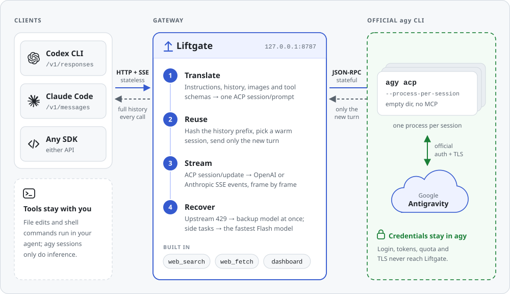

# Architecture

Liftgate turns stateless HTTP APIs into stateful ACP sessions. Clients send
OpenAI Responses or Anthropic Messages requests; Liftgate runs each turn
through the official `agy acp` CLI and streams the answer back in the format
the client asked for. Contributor rules for this design are in
[AGENTS.md](../AGENTS.md).

<picture>
  <source media="(prefers-color-scheme: dark)" srcset="../assets/readme/how-it-works-dark.svg">
  
</picture>

## Why ACP

Many proxies scrape local OAuth tokens, patch closed binaries or spoof private
headers. Those break easily, can leak credentials and may violate the terms of
service. Liftgate does none of that:

- It talks to Antigravity only through `agy acp`, the JSON-RPC 2.0 over stdio
  interface the CLI ships for editors and IDEs.
- Login (`agy acp --login`), token refresh, quota and upstream TLS stay inside
  the `agy` process. Liftgate never reads credentials.
- No binary patching, no injected certificates, no private endpoints.

## The request path

### Translate

Each request is normalized into one ACP `session/prompt`: instructions,
multi-turn history, images and the client's tool definitions. OpenAI
`instructions` and `developer` / `system` items go into the prompt as
`<developer_instructions>` blocks rather than ACP's system-prompt extension,
which avoids upstream `429`s on large harness prompts and keeps session hashes
stable. Volatile harness noise (billing headers, `cch=...`, token budgets,
timestamps) is stripped before hashing and forwarding.

### Inference-only sessions

Each ACP session runs in its own `agy acp --process-per-session` process,
inside an isolated empty directory and with `mcpServers: []`. `agy` therefore
has nothing to edit or execute: it only reasons. Tool calls go back to the
client, so Codex or Claude Code keeps running file edits and shell commands
under its own permissions. Liftgate itself serves `web_search` and an
SSRF-safe `web_fetch` that refuses private, loopback and link-local addresses.

### Session reuse

HTTP clients resend the whole conversation every turn. Liftgate hashes the
normalized message prefix and looks it up in `SessionPool`, a bounded LRU of
warm ACP sessions (`--max-idle-sessions`, default 64). On a hit it sends only
the new turn or tool results; on a miss it opens a new session and sends the
full history once.

### Streaming

ACP `session/update` notifications (`agent_thought_chunk`,
`agent_message_chunk`, tool calls) become OpenAI Responses or Anthropic
Messages SSE events frame by frame. `agy` retry banners are filtered out of the
text.

### Model routing

- **Failover.** When `agy` reports an upstream `429 RESOURCE_EXHAUSTED` or a
  fatal agent error, the turn moves to a backup model at once instead of
  waiting out `agy`'s own retries. Backups come from a short preference list
  of the same tier that your account can use.
- **Fast lanes.** Auxiliary requests (Claude Code Auto Mode classifiers, web
  search sub-requests, title and topic generation, away recaps) go to the
  fastest available `gemini-*-flash-low` model on short-lived sessions, so they
  never evict or change your cached main session.
- **Defaults.** An unknown or generic model name maps to `--default-model`.

## Process supervision

Liftgate owns every `agy` child it starts. On Windows they run in a Job Object
with `KILL_ON_JOB_CLOSE`; on Unix in their own process group, killed with
`killpg`, plus `PR_SET_PDEATHSIG` on Linux. A panic hook cleans up too, so
closing or crashing the gateway never leaves `agy` processes behind.

## Workspace

| Path | Owns |
| --- | --- |
| `crates/liftgate-types` | protocol, wire and config types: no async runtime, HTTP or I/O |
| `crates/liftgate-server` | HTTP/SSE routes, ACP transport, `SessionPool`, process supervision, `web_fetch`, telemetry |
| `crates/liftgate` | the `liftgate` CLI binary: global daemon lifecycle (`start`/`stop`/`restart`/`status`/`logs`/`ui`/`models`/`doctor`), embedded `web/dist` assets, non-destructive `config` sync, and zero-side-effect `claude` / `codex` launchers |
| `web/` | the dashboard (Bun, Vite, React 19, Tailwind CSS v4, shadcn/ui), embedded into release `liftgate` builds via `crates/liftgate/build.rs` |
| `run-gateway.{sh,ps1,cmd}` | build and run the gateway |
| `start-agy.{sh,ps1,cmd}` | launch Claude Code or Codex through the gateway |

Dependencies point one way: `liftgate` → `liftgate-server` → `liftgate-types`.
