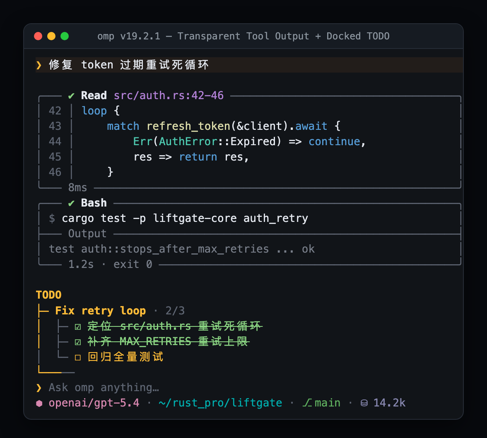
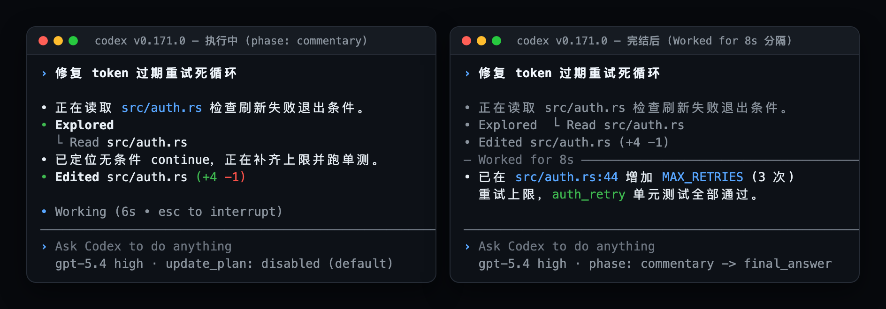
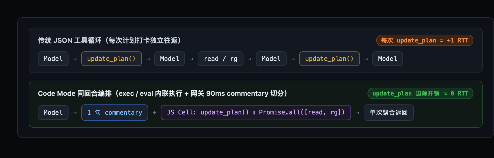

# 从外置计划工具到 Code Mode：Coding Harness 工作过程可读性的演进与实现对比

在终端或 IDE 中观察 Coding Agent 执行长链路编码任务时，界面上呈现的进度提示、工具卡片与任务清单并非单纯的前端排版问题，而是**模型后训练分布（RL 停止条件）**、**工具调用往返成本（RTT 与上下文重算）**以及**流式传输协议（消息相位分层）**共同决定的工程结果。

本文以 `Codex CLI` 的四个演进阶段为主线，在对应节点横向对比 `Antigravity`、`pi` / `omp`（`Oh My Pi`）与 `Claude Code` 在可读性上的不同实现取舍，并重点剖析 **Code Mode（代码编排模式）** 的出现如何将 `update_plan` 等全局计划工具的边际 RTT 开销压降至趋近于 `0`，从而改变这一演进路径的底层权衡。

---

## 一、问题定义：两个可读性视距与传统工具调用的成本约束

当模型连续执行十余步检索、修改与测试命令时，开发者对“工作过程可读性”通常包含两个不同尺度的信息诉求：

1. **宏观视距（全局进度状态）**：整体任务被拆解为哪些步骤？当前处于哪一步？剩余工作量还有多少？
2. **微观视距（单步执行上下文）**：当前这一步为什么触发该工具？上一步读取或测试返回了什么关键结果，促使模型做出下一步决策？

在传统的 JSON `function_call` / `tool_use` 交互循环中，提供上述两类信息需要付出明确的协议成本：

- **独立工具调用的 RTT 开销**：若通过 `update_plan` / `TodoWrite` 等工具维护全局清单，每次单独调用都意味着一次完整的 `Model → Harness → Model` 往返（`+1 RTT`），伴随全量历史上下文的重新 Prefill 与首字延迟（TTFT）。
- **上下文窗口占用**：多次更新计划会在消息历史中留下多份结构化 JSON 参数与回执快照。
- **自然语言输出与 RL 停机分布耦合**：端到端强化学习（RL）训练的编码模型对“输出面向用户的自然语言段落”与“结束当前回合（EOS）”高度敏感，直接靠提示词要求模型边说边做容易干扰工具调用链路。

不同 Harness 在不同阶段的设计差异，本质上都是围绕这三项约束所做的取舍。

---

## 二、第一阶段：外置脚手架期（早期 `Codex CLI`）与“全局 Todos”路线的不同实现

### 2.1 早期 `Codex CLI`：`Preamble` 话术 + 独立 `update_plan` 调用

在 `o3` / `o4-mini` 等早期推理模型阶段，模型在多步工具调用中容易出现目标漂移，且内部推理链对用户不可见。早期 `Codex CLI` 因此采用了**提示词预告（Preamble）+ 独立计划工具（`update_plan`）**的组合方案：

- 要求模型在调用工具前先输出 1～2 句操作预告；
- 要求模型在任务推进过程中定期调用 `update_plan`，维护 `pending` / `in_progress` / `completed` 状态列表（限定同一时刻最多一个 `in_progress` 项）。


这一设计中的 `update_plan` 同时承担两项职能：**对内**作为写入对话历史的“外置工作记忆”，让模型在后续轮次通过回读 JSON 清单锚定任务进度；**对外**则渲染为终端里的步骤勾选面板。

其工程代价直接体现在调用频次上：如上图所示，完成“读取定位 → 修改代码”两次实际操作，往往伴随三次独立的 `update_plan` 调用，每次状态流转都消耗额外的一轮模型采样与网络往返（`+1 RTT`）。

### 2.2 同源思路下的横向实现对比：`Antigravity` 与 `pi` / `omp`

围绕“保留全局 `Todos` / `Plans`，但不强制模型在每步工具间输出过渡解说”这一思路，当前不少主流 Harness 演化出了两种具有代表性的实现细节：

1. **折叠底层工具细节 + 全局 `Plans` 面板（如 `Antigravity` 及多数 GUI / IDE Harness）**：
   这类桌面或 IDE 集成环境通常舍弃中间状态的自然语言解说，在界面顶层或侧栏提供结构化的全局 `Plans` / `Todos` 卡片展示宏观阶段，同时将中间连续发生的十余次文件读取与命令执行折叠为紧凑的操作条目列表。这种方式减少了中间文本噪音，宏观阶段一目了然，但模型在两个工具调用之间的微观推理转折不单独生成人类语言说明。
2. **全局停靠 `TODO` 面板 + 完全透明的工具内容输出（如 `pi` / `omp`）**：
   `pi` 与 `omp`（`Oh My Pi`）同样不依赖工具前的过渡话术，而是将全局任务状态固定停靠在输入框上方（`ui/styles/dock/todo.ts` 中的树状脊柱 `TODO` HUD，按阶段聚合 `☑` 已完成删除线项与 `☐` 当前高亮项，并在底部拐角 `└─────` 上按比例填充整体进度）。
   与折叠工具详情的做法不同，`omp` 通过高信息密度的圆角工具卡片（`ui/styles/tools/{frame,read,bash,edit}.ts`）将每一步调用的**完整上下文直接摊开**：



   如上图所示，`Read` 卡片直接展示带行号与语法高亮的源码切片及耗时（`8ms`），`Bash` 卡片直接呈现执行命令、标准输出尾行、总耗时与退出码（`1.2s · exit 0`）。开发者无需展开折叠面板或依赖模型口头转述，即可通过完全透明的原始输入输出自行判断每一步的执行状态。

---

## 三、第二阶段：RL 编码模型的分布碰撞（`GPT-5-Codex` 早期）

当底层模型演进到针对长程软件工程进行端到端强化学习训练的 `GPT-5-Codex` 时，第一阶段依赖系统提示词强制要求“工具前先输出自然语言说明（Preamble）”的做法遇到了明显的分布冲突：


- **Preamble 诱发回合早停（左栏）**：在端到端编码 RL 训练分布中，输出一段面向用户的完整陈述句与“最终交付（EOS）”高度关联。当外部 Harness 提示词要求模型先汇报打算做什么时，模型在输出完计划陈述句后容易直接触发停止条件，以 `0 tool calls` 提前结束当前回合。
- **移除 Preamble 后的静默执行（右栏）**：为保障多步工具调用链的连续性，`GPT-5-Codex` 提示词指南建议移除工具前 Preamble 约束。去掉该提示词后，模型能够稳定地连续完成检索、编辑与测试，但在协议层尚未改造前，执行过程仅剩工具调用记录。

---

## 四、第三 & 第四阶段：`Codex CLI` 的反向精简——协议分层与默认禁用 `update_plan`

为在不干扰 RL 工具调用稳定性的前提下恢复中间过程可读性，OpenAI 将消息分层下沉至 **Responses API 协议层**，并在 `codex-cli >= v0.152.0` 中做出了与 `Antigravity` / `omp` 方向相反的取舍：



1. **协议级输出相位拆分（`phase: "commentary"` vs `phase: "final_answer"`）**：
   模型输出的 `message` 项显式携带 `phase` 属性。工具执行期间发出的单句说明标记为 `commentary`（不触发模型的终态收尾分布），任务全部完成后才输出 `final_answer`。终端在执行期流式展示 `•` 进度说明，完结后通过 `─ Worked for Xs ─` 分隔线（桌面端则自动折叠中间日志）将执行过程与最终结论解耦。
2. **默认禁用 `update_plan`（`openai/codex#41744`）**：
   得益于 Responses API 支持跨轮回传加密的 `reasoning` 状态项，模型不再依赖往上下文写入 JSON 计划来维持长程方向感。为了彻底省去独立计划工具带来的额外 RTT 与状态维护开销，`codex-cli v0.152.0` 将 `tools.update_plan` 调整为默认关闭（需手动配置开启），仅保留轻量的单句 `commentary`。

至此，纯工具调用时代的演进呈现出清晰的两端分化：一端（如 `Antigravity`、`omp`）重在保留结构化的全局 `Todos` 面板（辅以折叠列表或完全透明的工具输出）；另一端（如新版 `Codex CLI`）则默认裁掉全局 `Todos` 工具以换取零额外 RTT，仅用协议级 `commentary` 交代单步意图。

---

## 五、Code Mode 对可读性成本结构的改变：让 `update_plan` 趋近于 `0-RTT`

### 5.1 双视距并存诉求与 `Claude Code` 的交互结构

在实际复杂工程中，局部意图解说与全局进度面板各自解决不同维度的问题：`Claude Code` 的终端界面便是典型的双视距并存设计（下图左栏）——模型在调用 `Read` / `Update` / `Bash` 前输出带 `●` 的单句说明，工具下方以 `⎿` 缩进展示读取行数或内联 Diff 摘要，同时通过 `Update Todos`（`TodoWrite` / `TaskUpdate`）维护 `☒` / `☐` 任务列表与底部 `✻` 状态栏。

但在传统的逐工具 JSON 调用模式下，如果模型为了刷新任务状态而单独发起一次 `TodoWrite` 或 `update_plan` 请求，依然需要承担额外的工具往返成本。真正打破“保留全局计划”与“零额外 RTT”之间取舍关系的，是 **Code Mode（代码编排模式）** 的普及。

### 5.2 Code Mode 如何抹平 `update_plan` 的边际 RTT 开销

无论是 `Codex` 的 V8 `exec` 隔离沙箱、`omp` 的 `eval` 持久化多语言内核（Bun JS / Python），还是 `Liftgate (lg)` 暴露给客户端的 `mcp_lg_exec`，它们的核心机制都是**允许模型在单次输出中编写一段可执行脚本，在本地运行时内组合编排多个工具调用**。


观察上图右栏（`lg cx` 运行在 Code Mode 下），`update_plan` 的调用方式发生了本质变化：

```javascript
await tools.update_plan({
  explanation: "定位重试逻辑后补齐上限并跑单测",
  plan: [
    { step: "定位 src/auth.rs 重试死循环", status: "completed" },
    { step: "补齐 MAX_RETRIES 重试上限", status: "in_progress" },
    { step: "运行 cargo test 验证修复", status: "pending" },
  ],
});

const [authSlice, retryRefs] = await Promise.all([
  tools.exec_command({ cmd: "sed -n '35,60p' src/auth.rs" }),
  tools.exec_command({ cmd: "rg -n 'MAX_RETRIES' crates/" }),
]);
text(authSlice.output + "\n" + retryRefs.output);
```

这一变化从三个层面改写了可读性的工程账本：

1. **边际 RTT 开销降为 `~0`**：
   模型原本就必须发起一次回合来读取 `src/auth.rs` 和检索符号。在 Code Mode 下，`await tools.update_plan(...)` 作为同一段 JS 脚本的第一行语句在本地沙箱内直接派发给客户端，耗时仅为亚毫秒级的本地 IPC，**不再触发独立的 `Model → Harness → Model` 采样往返，也不产生额外的全量上下文重算**。
2. **多路探索与状态同步合并为单一上下文单元**：
   原本需要“1 次 `update_plan` + 2 次串行/并行命令调用”的多条工具消息，被收敛进单个 `exec` / `eval` 单元格（可在沙箱内用 `store` / `load` 缓存原始大输出，仅通过 `text(...)` 回传精简摘要），显著降低了历史消息膨胀。
3. **兼容跨后端模型的长程状态锚定**：
   对于未接入私有跨轮加密 `reasoning` 状态的通用模型网关场景，以 `~0 RTT` 成本保留结构化 Checklist，既为终端 UI 提供了实时全局进度面板，又在不牺牲吞吐的前提下保留了上下文内的任务坐标。

---

## 六、网关层的协议桥接细节（以 `Liftgate` 实现为例）

当底层后端为仅输出连续文本 chunk 与标准工具调用的 `agy acp` 通道时，要在网关层同时支撑上述多类 Harness 的可读性机制，需要处理好编排注入、流式切分与缓存一致性三处细节：



1. **跨 Harness 的 Code Mode 与任务工具路由**：
   - 针对 `Codex CLI`，`crates/liftgate-types/src/session_key/system_append.rs:125` 在桥接规则中引导模型于同一回合先输出单句进度说明，再在 `mcp_lg_exec` 内联调用 `await tools.update_plan(...)` 与 `Promise.all` 并发读取；
   - 针对 `omp`，`crates/liftgate-tool-virtualizer/src/profiles/omp.rs:273` 将多语言编排内核 `eval` 与任务屏障 `wait` 固定在 Tier-0 直通层，保留其 `tool.<name>(args)` 原生编排能力；
   - 针对 `Claude Code`，`crates/liftgate-tool-virtualizer/src/profiles/claude_code.rs:28` 将 `TodoWrite`、`TaskCreate`、`TaskUpdate` 保留在 Tier-1 常驻工具集中，避免在挂载大量 MCP 工具时被虚拟化折叠。
2. **语法感知 + `90ms` 空闲窗口合成 `phase: "commentary"`**：
   上游普通流式文本不包含 `phase` 字段。`crates/liftgate-server/src/turn_runner.rs:1469` 在工具调用参数生成前，先校验围栏代码块（` ``` `）闭合与行内反引号（`` ` ``）配对，再结合句末标点（`.`、`!`、`?`、`。`、`；` 等）与 `90ms` 流空闲窗口切分出独立的 `CommentaryBoundary` 事件，由 `crates/liftgate-server/src/routes.rs:975` 映射为 Responses API 的 `phase: "commentary"` 消息项，避免把半截代码或半句话切碎。
3. **热会话前缀的双哈希对齐**：
   将单轮模型输出拆分为 `commentary` + `final_answer` 两条消息后，客户端下一轮回传的历史消息结构会与网关合并态不同。`crates/liftgate-server/src/turn_runner.rs:1501` 通过 `compute_merged_text_alt_hash` 同时注册“拆分态哈希”与“合并态备用哈希”，保证 `SessionPool` 热会话前缀复用不受流式分段影响。

---

## 七、主流 Harness 可读性实现方案对比总表

不同工具基于各自的目标场景与协议假设选择了不同的组合方式，核心实现差异如下：

| 方案 / 阶段 | 全局进度机制（Todos / Plan） | 单步中间意图呈现 | 工具调用与结果透明度 | 维护全局计划的边际 RTT | 任务结束后的界面收束 |
| --- | --- | --- | --- | --- | --- |
| **早期 `Codex CLI`（Stage 1）** | 强制调用 `update_plan` | 提示词强制 `Preamble` | 展示命令摘要 | 每次更新 **`+1 RTT`** | 保留平铺调用记录 |
| **`Antigravity` 等 GUI Harness** | 顶层/侧栏全局 `Plans` 面板 | 不单列中间过渡解说 | 默认折叠为紧凑操作列表 | 独立工具更新 **`+1 RTT`** | 汇总为 `Worked for Xm` 折叠块 |
| **`pi` / `omp`（Oh My Pi）** | 输入框上方停靠树状 `TODO` HUD | 不强制过渡话术 | **圆角卡片完整展示源码行、输出尾行与耗时** | 独立 `todo` 调用 **`+1 RTT`**（或经 `eval` 内联） | 保留结构化工具卡片流 |
| **新版 `Codex CLI`（`>= v0.152.0`）** | **默认禁用 `update_plan`**（Opt-in） | 协议级 `phase: "commentary"` | 聚合为 `Explored` / `Edited` 摘要 | **`0`**（默认无计划调用） | `─ Worked for Xs ─` 分隔线 / 折叠 |
| **`Claude Code`** | `Update Todos` + 底部动态清单 | 工具前 `●` 单句说明 | `⎿` 缩进摘要与内联 Diff 片段 | 独立调用 **`+1 RTT`**（同回合并行 `tool_use` 可摊薄） | 保留滚动记录与最终结论 |
| **Code Mode 编排（`exec` / `eval` / `lg cx`）** | 沙箱内联 `await tools.update_plan(...)` | 单句 `commentary` 实时切分 | 单一 `Ran JS` / `Eval` 聚合编排与按需摘要 | **`~0 额外 RTT`（寄生于业务探索回合）** | `─ Worked for Xs ─` 分隔线 / 折叠 |
