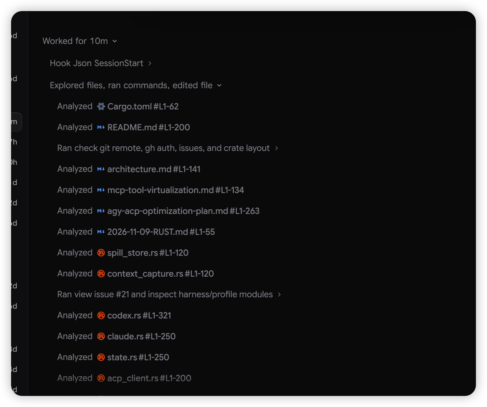
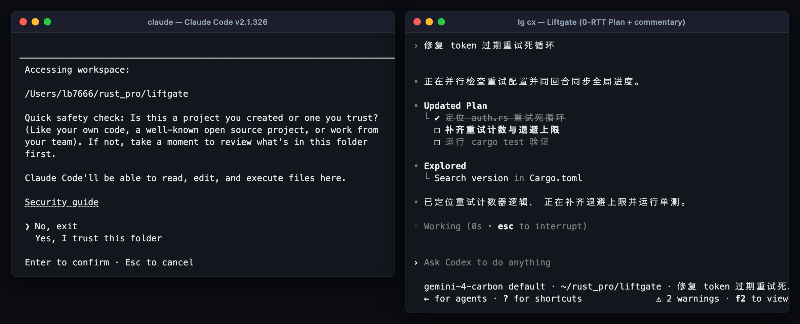
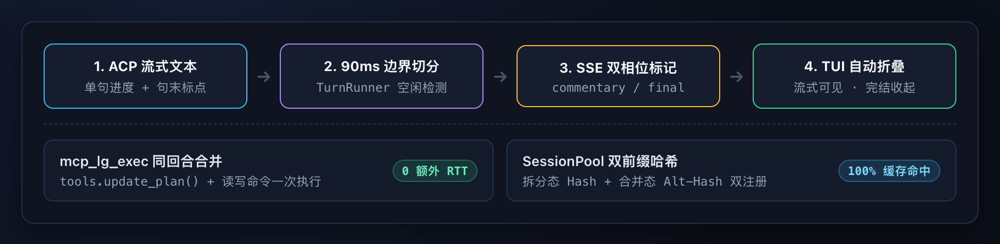

# 为了让人类读懂 AI 干活：Coding Harness 与模型协同设计的演进史

在终端里看 Coding Agent 写代码，表面上只是几行滚动的进度提示与勾选框；但在底层，这是**模型后训练分布（RL 停止条件）**、**上下文经济学（RTT 往返延迟与 KV Cache 命中率）**以及**流式传输协议（SSE 相位分层）**三方反复博弈的产物。

本文以 `Codex CLI` 的四阶段演进为主线，横向对比 `Antigravity` 等停留在早期形态的产品、`Claude Code` 的双层感知演进，以及 `Liftgate (lg)` 在网关层兼顾「微观解说 + 全局进度 + 零额外轮次税」的协议工程细节。

---

## 一、核心矛盾：人类需要什么，而模型讨厌什么？

当 Agent 连续执行十几步搜索、修改与编译测试时，人类开发者在屏幕前同时需要**两个视距**的信息：

1. **宏观视距（Global Horizon）**：整体拆成了哪几步？当前推进到了第几步？距离结束还有多远？
2. **微观视距（Local Horizon）**：**此时此刻**为什么调这个工具？刚刚读完文件发现了什么根因，才决定去改下一个文件？

然而，直接用 Prompt 强迫模型“边干活边填表汇报”，会立刻撞上三大工程反噬：

- **RTT 往返税**：每一次独立的计划更新工具调用（如 `update_plan`）都要额外消耗一次模型采样与工具往返。
- **上下文污染**：长链路对话历史里塞满十几份过期的 JSON 清单快照，挤占有效代码上下文。
- **RL 行为分布冲突**：端到端强化学习（RL）训练的编码模型对“何时说人话、何时调工具、何时停机（EOS）”极其敏感，生硬的话术指令极易诱发早停或空转。

---

## 二、Codex CLI 工作过程可读性的四个演进阶段

### 第一阶段：外置脚手架期（o3 / o4-mini 与早期 Codex CLI）

早期推理模型跨多步工具调用时容易在中途丢失最初的任务边界，且推理过程对用户完全黑盒。为此，早期 `Codex CLI` 采用了**强提示词约束 + 外置状态工具**的组合拳：

- **强制工具前预告（Preamble）**：要求模型每次调工具前先输出 1～2 句口头说明。
- **高频调用 `update_plan`**：强制维护 `pending` / `in_progress` / `completed` 状态机（且严格限制同一时刻只能有一个 `in_progress` 步骤）。


这一阶段的 `update_plan` 同时承担了双重职责：**对外是给人类看的终端进度面板；对内则是借工具调用往上下文里定时写入一份“外置工作记忆”**，靠模型每轮回读历史里的 JSON 清单来防止迷失方向。

但它的代价同样显著：**干 3 次实事往往要配 3 次 `update_plan` 打卡**，哪怕只是改两行配置，模型也要机械地走完“立项 → 打勾 → 结项”的形式主义流程，端到端耗时与 Token 开销居高不下。

---

### 同期行业痛点对比：从“纯裸工具流”到停留在第一阶段的 `Antigravity`

即便在今天，市面上绝大多数 Coding Harness 在可读性设计上依然停留在第一阶段甚至更早的原始形态。下图是一段真实的 `Antigravity` 长耗时工作界面（`Worked for 10m`）：



这种滞后形态给开发者带来两层非常直观的痛苦：

1. **漫长机械工具流带来的“失控感”**：
   如上图真实记录所示，在长达 10 分钟的执行过程中，展开详情后只有一排排冰冷的 `Analyzed Cargo.toml`、`Analyzed spill_store.rs`、`Ran check git remote...`、`Analyzed codex.rs` 机械罗列，**中间没有任何一句人类可读的过渡解说**。用户完全无从得知：模型读完 `spill_store.rs` 发现了什么线索？为什么紧接着跳去看 `codex.rs` 和 `acp_client.rs`？当前思路到底走对了还是在死胡同里打转？
2. **“仅全局 Plans / Todos”模式的半成品局限（以 `Antigravity` 及诸多传统 IDE Agent 插件为代表）**：
   平心而论，挂一个全局可读的 Plans / Todos 面板确实比纯裸刷工具调用稍微好一点——用户起码知道大方向拆成了几步。但它依然停留在第一阶段的思维定式：**只有宏观大步打勾，零微观因果解说**。全局步骤长时间停在某一项 `In Progress`，底下的活动流依旧是沉默的工具刷屏；更糟糕的是，每次维护全局步骤本身还要消耗额外的独立工具调用轮次。

---

### 第二阶段：RL 编码模型的“去啰嗦”纠偏与静默阵痛（GPT-5-Codex 早期）

当模型演进到针对长程软件工程端到端 RL 训练的 `GPT-5-Codex` 时，第一阶段的 Preamble 提示词引发了严重的协议水土不服：


- **“汇报即早停”（Abrupt Stoppage）**：在 RL 训练分布中，“向用户输出一段完整的自然语言段落”与“当前回合任务交付完毕（EOS）”高度耦合。当旧版 Harness 提示词强迫模型在调工具前先说一段话（如*“我接下来去检查 `auth.rs` 并修复重试上限。”*），模型输出完句号便误判回合已结束，直接以 `0 tool calls` 停机，把半截任务扔回给用户。
- **一刀切砍掉话术后的“哑巴期”**：OpenAI 在 `GPT-5-Codex` 提示词指南中紧急建议移除工具前 Preamble 指令。去掉提示词干扰后，模型确实能一口气连调十几个工具把代码改完测通，但整个执行过程变成了**只有 `Thinking…` 和工具命令行的静默黑盒**——为了保住模型的执行稳定性，牺牲了人类的实时可读性。

---

### 第三 & 第四阶段：协议级双相位分层与默认下线 `update_plan`（`codex-cli >= v0.152.0`）

要让模型“既开口解释当下动作，又绝不把解释当成停机信号”，靠 Prompt 打补丁已经走不通了。OpenAI 选择把可读性下沉到 **Responses API 协议层与模型后训练结构**中，完成了向极简模式的跃迁：


1. **输出通道原生一分为二（`phase: "commentary"` vs `phase: "final_answer"`）**：
   模型输出的 `message` 项新增一等公民字段 `phase`。在探索代码、切换阶段或发现关键结论前，模型在 `commentary` 相位发出一句精炼进度（不触发 EOS 停机偏置）；真正完工后才切换到 `final_answer` 输出完整结论。
2. **过程与结论清晰分层（CLI `─ Worked for Xs ─` 分隔线 / GUI 自动折叠）**：
   如上图左右对比所示：执行期间，`Codex CLI` 实时流式展示每一条 `•` 进度 `commentary` 与聚合后的 `• Explored` 动作；一旦 `final_answer` 完成，终端以一条清晰的 `─ Worked for Xs ───` 分隔线将中间探索过程与最终自包含结论切分开来（在桌面端与 Web 端则直接将过程收起为可展开折叠条）。
3. **原生推理链替代外置笔记，`update_plan` 改为默认关闭（`openai/codex#41744`）**：
   借助 Responses API 跨轮透传的加密推理状态（`reasoning.encrypted_content`），模型内部的长程规划记忆得以跨工具回合无损延续，不再需要靠每步调 `update_plan` 往上下文塞 JSON 防迷失。因此自 `codex-cli v0.152.0` 起，内置 `update_plan` 正式改为默认关闭（需通过 `tools.update_plan.enabled = true` 手动开启），彻底省去了计划打卡的额外 RTT 开销。

---

## 三、双视距合流：为什么 `Claude Code` 与 `Liftgate (lg)` 选择“全都要”？

`Codex CLI` 第四阶段的极简主义非常适合中短链路任务，但在长达数十分钟、横跨十几个模块的复杂重构中，**完全砍掉全局 Checklist 会带来新的盲区**：

- **对人类而言**：只有滚动的单句 `commentary` 缺少全局锚点——用户知道模型这一秒在干嘛，但不知道整个重构究竟做到了 `20%` 还是 `80%`。
- **对跨模型网关而言**：接入非 OpenAI 原生后端时，未必具备私有的跨轮加密 `reasoning` 状态直通，轻量级结构化 Checklist 依然是最稳健的防漂移护栏。

正因如此，行业最成熟的交互形态正在收敛向**“微观单句解说 + 宏观全局进度”的双视距融合**——这也是目前 `Claude Code` 与 `Liftgate (lg)` 共同采用的路线：



- **`Claude Code` 的双层体验**：
  如上图左所示，每次调用 `Read` / `Bash` / `Edit` 前先输出一行带 `⏺` 的简短动作解说（解决“当下为什么这么做”），同时在终端底部常驻 `✻` 动态进度条与 `✔` / `◼` / `◻` 全局任务清单（解决“整体走到哪一步”）。
- **`Liftgate (lg)` 的“零税率”增强融合**：
  如上图右所示，`lg cx` 在对齐 `Claude Code` 双层感知的同时，利用 Code Mode（图中 `• Ran JS`）在同一个模型回合内并发执行 `await tools.update_plan(...)` 与代码检索命令，实现 **`0 额外 RTT` 刷新 `• Updated Plan`**，并同时保留 `Codex` 第四阶段的单句 `commentary` 实时播报与 `Worked for Xs` 阶段收束。

| 维度 | 裸工具流 Harness | `Antigravity` 等 Stage-1 面板 | `Codex CLI`（Stage 4 默认） | `Claude Code` | `Liftgate (lg)` 融合架构 |
| --- | --- | --- | --- | --- | --- |
| **宏观全局进度（Checklist）** | 无 | 有（顶部/侧栏步骤卡） | 默认关闭（Opt-in） | 有（常驻 Todos 面板） | **有（支持 Code Mode 内联同步）** |
| **微观单步解说（为什么调工具）** | 无 | **无（静默刷工具）** | 有（`phase: commentary`） | 有（`⏺` 工具前短解说） | **有（90ms 实时切分 `commentary`）** |
| **更新进度的额外 RTT 开销** | 0 | 每次更新 `+1 RTT` | 0 | 独立 `TodoWrite` 约 `+1 RTT` | **`0 额外 RTT`（与读写命令同回合合并）** |
| **任务结束后的界面层次** | 满屏工具日志 | 折叠后仍无过程语义 | **`Worked for Xs` 分隔/折叠** | 保留滚动记录 | **`Worked for Xs` 分隔/折叠** |

---

## 四、幕后的煞费苦心：`Liftgate` 为可读性做了哪些底层协议工程？

要把上游只输出普通流式文本与工具调用的 `agy acp` 后端，转化为客户端眼中最丝滑的“实时单句解说 + 0-RTT 全局进度 + 完结自动折叠 + 热会话零断连”，`Liftgate` 在网关内部构建了一整套精密的状态机：



### 1. Code Mode 同回合编排：把 `update_plan` 降为 `0-RTT`

在 `crates/liftgate-types/src/session_key/system_append.rs:125-140` 的 `<api_gateway_bridge_rules>` 契约中，`lg` 将 `update_plan` 直接挂载进 `mcp_lg_exec`（V8 Code Mode 沙箱）的 `tools` 对象：

- 模型在同一个回合内先输出 **1 句精炼进度解说**（以 `.` 或 `。` 结尾），紧接着在单次 `mcp_lg_exec` 调用里并行完成 `await tools.update_plan(...)` 与 `await Promise.all([tools.exec_command(...), ...])`；
- 对于 `Claude Code` 客户端，`crates/liftgate-tool-virtualizer/src/profiles/claude_code.rs:28-31` 将 `TodoWrite`、`TaskCreate`、`TaskUpdate` 锁定在 Tier-1 核心保活槽位，即使挂载上百个 MCP 插件也绝不驱逐全局进度工具。

### 2. 语法感知的 `90ms` 空闲边界切分：无中生有合成 `commentary` 相位

上游 ACP 流只吐连续的 `agent_message_chunk` 文本，并没有原生的 `phase: "commentary"` 标记。如果等工具调用出现才刷新文本，用户在漫长的工具参数生成期间将看不到任何提示；如果按任意 chunk 乱切，又会把半句话切成破碎的气泡。

为此，`crates/liftgate-server/src/turn_runner.rs:1469-1665` 实现了 `ends_at_commentary_boundary` 与 `COMMENTARY_IDLE_FLUSH_DELAY`（`90ms`）双条件切分器：

1. **语法完整性校验**：实时扫描围栏代码块（` ``` `）闭合状态与当前行行内反引号（`` ` ``）奇偶配对，确保绝不在代码片段中间劈开消息；
2. **句末标点 + 90ms 微停顿确认**：仅当文本以完整句末标点（`.`、`。`、`!`、`！`、`?`、`？`、`:`、`：` 等）收尾，且上游流在 `90ms` 内未继续追加后续正文（通常已转入工具调用生成或内部推理）时，立即触发 `TurnEvent::CommentaryBoundary`；
3. **SSE 双相位映射**：`crates/liftgate-server/src/routes.rs:975` 与 `1039` 将边界前刷出的消息块精准标记为 `"phase": "commentary"`，而将回合收尾的正式答复标记为 `"phase": "final_answer"`，原生驱动 `Codex CLI` 的实时展示与完结折叠。

### 3. `SessionPool` 双前缀哈希：绝不因 UI 分段而牺牲热会话复用率

流式切分还会引发一个极隐蔽的缓存雪崩陷阱：网关在第一轮把模型的连续输出切成了 `[Text("正在检查…"), Text("正在验证…")]` 多段以美化 TUI，但部分客户端在第二轮回传对话历史时，会把相邻纯文本段重新合并为单个 `Text("正在检查…\n正在验证…")`。一旦历史前缀哈希对不上，`SessionPool` 就会误判会话分叉，被迫销毁热进程冷启动重放！

为此，`crates/liftgate-server/src/turn_runner.rs:1501-1544` 专门设计了 `compute_merged_text_alt_hash`：每当回合内发生纯文本分段时，网关会同时计算**拆分态主哈希**与**合并态备用哈希（Alt-Hash）**并一并注册进 `SessionPool`。无论下游 Harness 下一轮如何归一化历史消息，都能 **100% 命中热会话缓存**。

---

## 五、结语

回顾这段演进史可以清晰看到：好的 Agent 可读性从来不是“写一句让模型多汇报的 Prompt”那么简单。

- 停留在早期阶段的产品要么让用户面对沉默滚动的裸工具流，要么像 `Antigravity` 那样只挂一块缺少中间因果解说的全局步骤板；
- `Codex CLI` 通过模型 RL 对齐与 API 协议层的 `commentary` / `final_answer` 分离，证明了**中间过程应当流式可见、完结即折叠，且绝不能靠高延迟工具打卡来维系记忆**；
- 而 `Claude Code` 与 `Liftgate (lg)` 进一步证明：**人类既需要看清脚下这一步的“一句话动机”，也需要抬头看见全局的“进度坐标”**——只要通过 `0-RTT` 沙箱编排、毫秒级流式边界切分与双哈希会话保活把底层开销归零，开发者就能同时拥有最透明的掌控感与最极致的执行吞吐。
