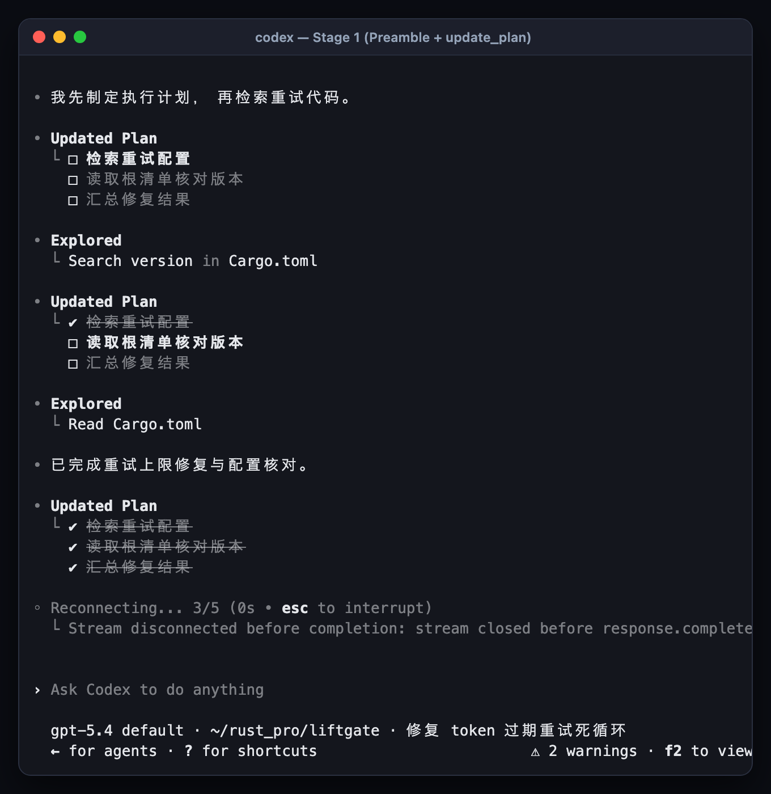
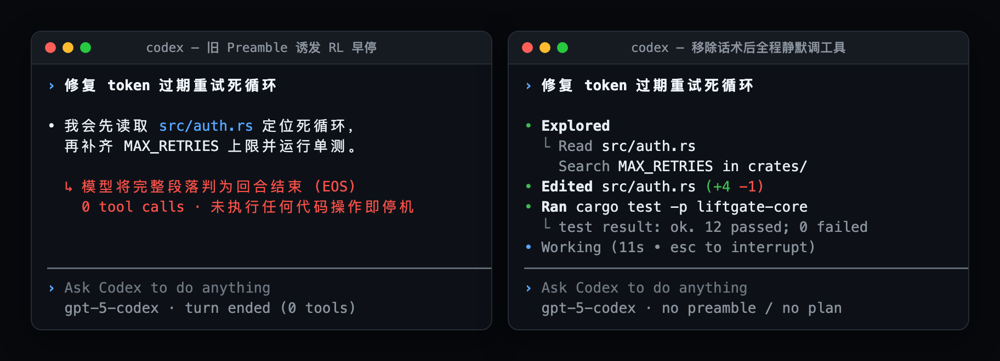
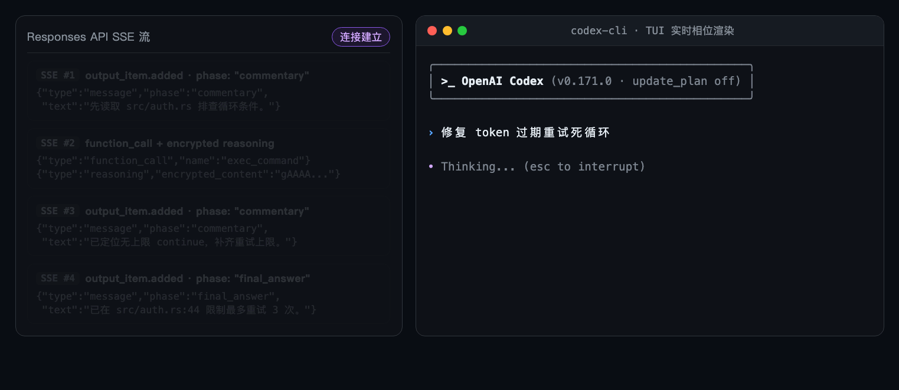
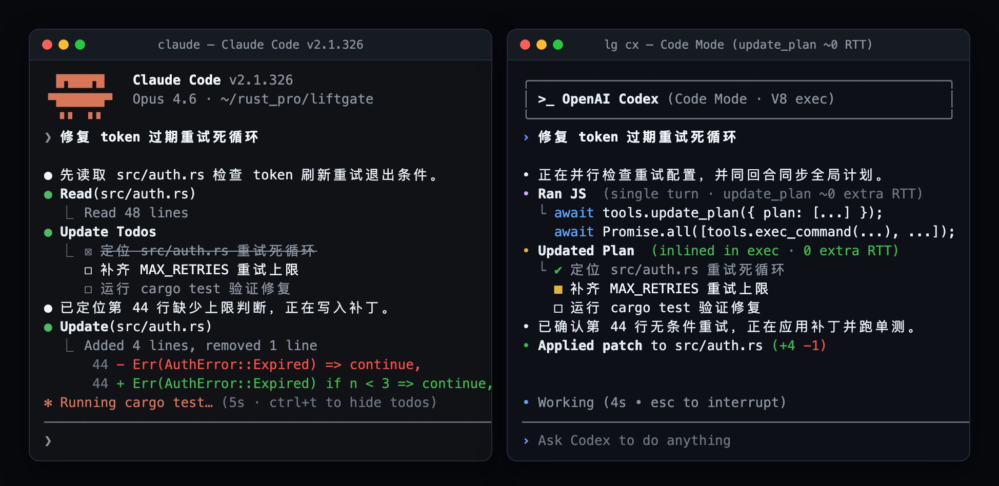
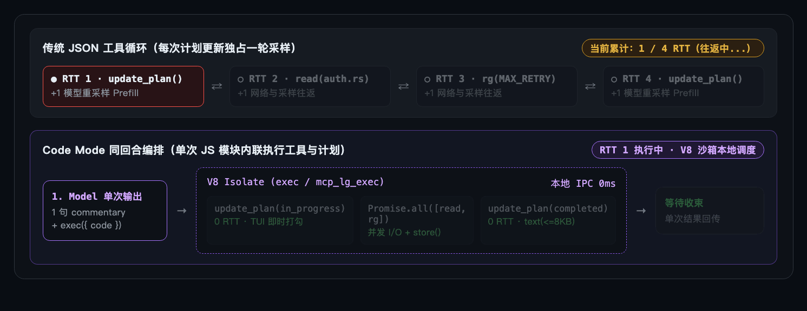
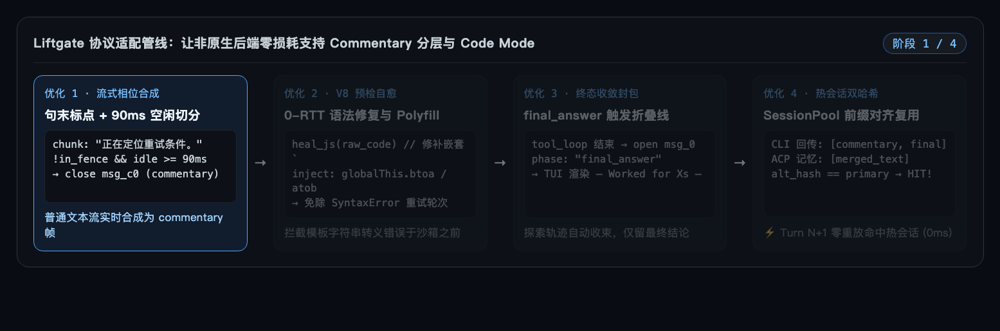

# 从外置计划工具到 Code Mode：Coding Harness 工作过程可读性的演进与实现详解

在终端或 IDE 中观察 Coding Agent 执行长链路编码任务时，界面上呈现的进度播报、工具卡片与任务清单并非单纯的前端 UI 设计问题，而是由**模型后训练分布（RL 停止条件）**、**System Prompt 约束演化**、**工具调用往返成本（RTT 与全量上下文重 Prefill）**以及**流式传输协议（消息相位分层）**共同决定的系统工程结果。

本文以 `Codex CLI` 的四个演进阶段为主线，逐阶段拆解其底层 **System Prompt 原文变化、工具 Schema 与流式报文结构**；在对应的演进节点横向对比 `Antigravity`、`pi` / `omp`（`Oh My Pi`）与 `Claude Code` 的具体工程实现取舍（不做优劣评判，仅剖析机制差异）；并结合动态交互示意图重点说明 **Code Mode（代码编排模式）** 如何将 `update_plan` 等全局计划工具的边际 RTT 成本压降至趋近于 `0`，以及网关层如何在非原生后端上无损合成整套协议体验。

---

## 一、问题定义：两个可读性视距与传统工具循环的三重约束

当模型连续执行十余步代码检索、修改与验证命令时，开发者对“工作过程可读性”通常存在两个不同尺度的感知需求：

1. **宏观视距（全局进度坐标）**：整体任务被拆解成了哪几个阶段？当前推进到哪一步？距离完成还有多少剩余项？
2. **微观视距（单步决策上下文）**：当前这一步为什么要调用该工具？上一条搜索或测试输出暴露了什么关键线索，促使模型改变方向？

在传统的 JSON `function_call` / `tool_use` 循环中，同时提供这两层信息会直接触碰三项底层协议约束：

- **独立工具调用的 RTT 税**：若通过 `update_plan` / `TodoWrite` 等工具维护全局清单，每一次单独发起计划更新都意味着一次完整的 `Model → Harness → Model` 往返（`+1 RTT`），伴随整段历史上下文的重新 Prefill 与首字延迟（TTFT）。
- **上下文窗口快照累积**：反复写入全量计划 JSON 会在对话历史中堆积多份过期的状态快照。
- **自然语言输出与 RL 停机分布耦合**：经端到端强化学习（RL）训练的编码模型对“输出面向用户的自然语言文本”与“结束当前回合（EOS）”高度敏感；直接用提示词强迫模型“先说话再调工具”，极易诱发模型提前终止工具链。

`Codex CLI` 与主流 Coding Harness 的代际演进，本质上都是围绕这三项约束展开的工程重构。

---

## 二、第一阶段：外置脚手架期（早期 `Codex CLI` · `o3` / `o4-mini`）

在 `o3`、`o4-mini` 等早期推理模型阶段，模型跨越多步工具调用时容易出现目标漂移，且内部推理链对终端用户是黑盒。早期 `Codex CLI`（`codex-rs/core/prompt.md`）为此在 **System Prompt** 与 **Tool Schema** 两层搭建了一套完整的外置脚手架。

### 2.1 System Prompt 实现：强制 `Preamble messages` + `Planning` 双重指令

在早期 `codex-rs/core/prompt.md` 中，系统提示词专门开辟了 `## Responsiveness` 与 `## Planning` 两个章节，显式要求模型在调工具前发送自然语言预告（Preamble），并在每步动作前后同步刷新计划状态：

```markdown
## Responsiveness

### Preamble messages

Before making tool calls, send a brief preamble to the user explaining what you’re about to do. When sending preamble messages, follow these principles and examples:

- **Logically group related actions**: if you’re about to run several related commands, describe them together in one preamble rather than sending a separate note for each.
- **Keep it concise**: be no more than 1-2 sentences, focused on immediate, tangible next steps. (8–12 words for quick updates).
- **Build on prior context**: if this is not your first tool call, use the preamble message to connect the dots with what’s been done so far and create a sense of momentum and clarity for the user to understand your next actions.
- **Keep your tone light, friendly and curious**: add small touches of personality in preambles feel collaborative and engaging.

## Planning

You have access to an `update_plan` tool which tracks steps and progress and renders them to the user...
Do not repeat the full contents of the plan after an `update_plan` call — the harness already displays it. Instead, summarize the change made and highlight any important context or next step.
Before running a command, consider whether or not you have completed the previous step, and make sure to mark it as completed before moving on to the next step.
```

### 2.2 工具 Schema 实现：全量覆盖式 `update_plan`

与之配套的内置工具 `update_plan` 采用**全量数组覆盖**而非增量补丁设计，严格限制同一时刻最多只能有一个 `in_progress` 步骤：

```json
{
  "name": "update_plan",
  "description": "Updates the task plan. Provide an optional explanation and a list of plan items, each with a step and status. At most one step can be in_progress at a time.",
  "parameters": {
    "type": "object",
    "properties": {
      "explanation": { "type": "string" },
      "plan": {
        "type": "array",
        "items": {
          "type": "object",
          "properties": {
            "step": { "type": "string" },
            "status": { "enum": ["pending", "in_progress", "completed"] }
          },
          "required": ["step", "status"]
        }
      }
    },
    "required": ["plan"]
  }
}
```

全量覆盖设计的初衷是让 `update_plan` 同时服务于两端：
- **对模型内部（外置工作记忆）**：每隔几步就把最新完整计划写入消息历史，后续轮次模型通过回读上下文里的最新 JSON 快照防止迷失方向；
- **对终端用户（可视化进度条）**：CLI 拦截该工具调用并渲染为 `• Updated Plan` 勾选树。



这一阶段的主要代价在于**轮次放大**：如上图所示，完成一次“读取定位 → 修改代码”的双步修复，前后往往穿插 3 次独立的 `update_plan` 工具调用，每一次状态流转都实打实消耗 `+1 RTT` 的模型重采样开销。

---

## 三、第二阶段：RL 编码模型的“去 Preamble”纠偏，以及同阶段无话术路线的三种实现

进入针对长程编码任务做端到端强化学习（RL）微调的模型世代（如 `GPT-5-Codex`）后，第一阶段靠提示词硬塞 `Preamble` 的做法遇到了严重的分布冲突；与此同时，行业内其他放弃“每步工具前自然语言解说”的 Harness（如 `Antigravity` 与 `pi` / `omp`），也在这个阶段演化出了截然不同的可读性实现路径。

### 3.1 `GPT-5-Codex`：早停（Abrupt Stoppage）诱因与 `gpt_5_codex_prompt.md` 的大删减

在 `GPT-5-Codex` 的 RL 训练轨迹中，中间执行轮次主要由内部 `reasoning` 块紧接 `function_call` 构成，而**向用户输出自然语言正文（Assistant Prose）在后训练分布中与回合终止符（`finish_reason: "stop"`）高度共现**。

当沿用第一阶段 `prompt.md` 中的 `### Preamble messages` 指令时，模型一旦先吐出 *“接下来我将读取 `src/auth.rs` 并补齐测试。”*，解码器生成 `<|endoftext|>` 的概率会瞬间飙升，导致模型在 **`0 tool calls`** 的状态下直接结束回合退回输入框。

为彻底消除早停，OpenAI 在 `codex-rs/core/gpt_5_codex_prompt.md` 中对 System Prompt 做了两处直接手术：

1. **整段移除 `## Responsiveness` / `### Preamble messages`（中间过渡话术规则归零）**：整份 `gpt_5_codex_prompt.md` 不再包含任何要求模型在工具调用前向用户解释动作的指令，仅保留任务末尾的 `## Presenting your work and final message`。
2. **大幅收缩 `## Plan tool` 触发频率**：将原先四大段规划说明压缩为仅 3 条极简规则，明确跳过约 25% 的常规任务：

```markdown
## Plan tool

When using the planning tool:
- Skip using the planning tool for straightforward tasks (roughly the easiest 25%).
- Do not make single-step plans.
- When you made a plan, update it after having performed one of the sub-tasks that you shared on the plan.
```



删去 `Preamble` 后，模型的工具链连续执行稳定性显著提升，但也带来了右侧终端所示的副作用：在没有触发 `update_plan` 的任务或两个计划节点之间，终端只剩下沉默滚动的 `• Explored` / `• Edited` 聚合行，用户在长耗时排查中难以获知模型的实时判断。

### 3.2 同阶段横向对比：同样不强制中间过渡话术，`Antigravity` 与 `pi` / `omp` 如何实现？

一旦在第二阶段放弃“要求模型每次调工具前输出一段对话式解说”，如果仍想让人类掌握执行状态，工程上自然分化出另外两条代表性路线——它们都保留了全局 `Todos` / `Plans` 锚点，但在**底层工具过程透明度**上做出了完全相反的取舍：

#### 路线 A：`Antigravity` 等 GUI / IDE Harness —— 顶层全局 `Plans` 面板 + 默认折叠工具流

以 `Antigravity` 为代表的许多图形界面 Harness 同样不要求模型在连续工具调用之间穿插自然语言解说，而是将可读性重心放在**宏观步骤卡片**：
- **全局计划层**：通过结构化步骤工具（如 `update_steps` / `Task` 面板）在界面顶部或侧栏维护 `pending` / `in_progress` / `done` 清单，让用户随时确认宏观阶段；
- **工具执行层**：中间连续十余次文件分析与命令执行默认收纳在紧凑的 `Analyzed ...` / `Ran ...` 列表乃至 `Worked for Xm` 折叠块内，界面保持克制整洁，但单步之间的微观推理转折不对外展开。

#### 路线 B：`pi` / `omp`（`Oh My Pi`）—— 同回合并行 `todo` 挂载 + 完全透明的工具输出卡片

`pi` / `omp` 同样不在 System Prompt 中要求模型输出对话式 `Preamble`，但它选择把**工具输入、源码片段与标准输出完全摊开在终端里**，并在提示词层严控 `todo` 工具的 RTT 开销：

1. **System Prompt 去话术与结构化 `intentTracing`**（`packages/coding-agent/src/prompts/system/system-prompt.md`）：
   `omp` 的主提示词零废话铺垫，直接声明轮次成本约束，并支持将 2～6 词的动名词短语作为**工具参数字段**（而非独立文本消息）传入：
   ```markdown
   # General
   Every turn costs seconds: batch independent reads, searches, and edits into the fewest turns. SHOULD resolve prerequisites, parallelize independent calls.
   - **Direct entry.** Request names a file? Read it on turn 1. Names a symbol or command? Search for it, or run only that command.

   # Tool I/O
   - Most tools take `intent`: capitalized 2–6-word present-participle intent (e.g. "Reading model role settings").
   ```

2. **严禁 `todo` 独占轮次的并行搭载规则**（`packages/coding-agent/src/prompts/tools/todo.md`）：
   为了避免第一阶段“每次打勾白白浪费 `+1 RTT`”，`omp` 在 `todo` 工具提示词第一句便强制模型利用多工具并行调用（Parallel Tool Calls）顺路捎带状态更新：
   ```markdown
   `todo` NEVER takes a turn of its own: emit it in the same response as your next real tool call (parallel tool calls), `init` beside the first read or action, `done`/`start` beside the next action or check. A response whose only call is `todo` wastes a full model round trip.
   ```

3. **TUI 全透明卡片与停靠式树状 `TODO` HUD**（`ui/styles/tools/{frame,read,bash}.ts`、`ui/styles/dock/todo.ts`）：
   - 每个 `Read`、`Bash`、`Edit` 调用均以独立圆角卡片（`╭─ ... ─╮`）直接展示带行号的真实源码片段、命令退出尾行与精确毫秒耗时（如 `8ms`、`412ms`）；
   - 输入框正上方常驻由 `├─`、`│` 与底部进度拐角 `└─────` 构成的树状脊柱 `TODO` 面板，实时映射 `☑`（完成删除线）与当前高亮阶段。


可以看到，在同属“去对话式 Preamble”的第二阶段设计空间里：`GPT-5-Codex` 选择了极简聚合摘要，`Antigravity` 选择了“全局 `Plans` + 折叠底层调用”，而 `omp` 则选择了“并行搭载 `TODO` HUD + 原生工具内容全量透明化”。

---

## 四、第三与第四阶段：协议级 `phase` 相位分层、加密推理链持久化与默认下线 `update_plan`

真正让 `Codex` 重新找回自然流畅的单步解说、同时不再复发 RL 早停问题的，不是提示词措辞微调，而是 **OpenAI Responses API 的底层协议升级**。

### 4.1 第三阶段：消息 `phase` 相位通道与 `Intermediary updates` 提示词回归

Responses API 在 `message` 输出项上正式引入了协议级字段 `phase`（枚举值 `"commentary"` 与 `"final_answer"`），并配合跨轮次透传的加密推理项 `reasoning.encrypted_content`：

```json
// 1. 中间过程播报帧：在模型训练分布中与后续 function_call 绑定，不会触发回合 EOS
{
  "type": "message",
  "id": "msg_01_c0",
  "role": "assistant",
  "phase": "commentary",
  "content": [{ "type": "output_text", "text": "先读取 src/auth.rs 排查重试循环条件。" }]
}

// 2. 跨轮次加密工作记忆：无需借 update_plan 往可见上下文写 JSON 笔记
{
  "type": "reasoning",
  "id": "rs_01",
  "summary": [{ "type": "summary_text", "text": "Inspecting auth retry loop" }],
  "encrypted_content": "gAAAAABn..."
}

// 3. 终态答复帧：明确标识整个工作流收尾，通知 TUI 收束中间轨迹
{
  "type": "message",
  "id": "msg_01_final",
  "role": "assistant",
  "phase": "final_answer",
  "content": [{ "type": "output_text", "text": "已在 `src/auth.rs:44` 限制最多重试 3 次。" }]
}
```

因为模型在后训练阶段原生学习了 `phase = "commentary"` 通道语义——输出 `commentary` 后继续生成 `function_call`，只有输出 `phase = "final_answer"` 才代表回合完结——`Codex` 新版内置 System Prompt 得以安全地重新引入详尽的 **`## Intermediary updates`** 规范：

```markdown
## Intermediary updates

- Intermediary updates go to the `commentary` channel.
- User updates are short updates while you are working, they are NOT final answers.
- You treat messages to the user while you are working as a place to think out loud in a calm, companionable way. You casually explain what you are doing and why in one or two sentences.
- You provide user updates frequently, every 30s.
- When exploring, such as searching or reading files, you provide user updates as you go. You explain what context you are gathering and what you are learning.
- Before performing file edits of any kind, you provide updates explaining what edits you are making.
```

### 4.2 第四阶段：`codex-cli >= v0.152.0` 默认禁用 `update_plan` 与终态折叠

当内部状态保持由 `encrypted_content` 接管、外部过程解说由 `phase: "commentary"` 接管后，传统的独立 `update_plan` 工具在原生 Responses API 链路中便成了纯粹的额外 Schema 负担与潜在的 `+1 RTT` 诱因。

因此自 `codex-cli v0.152.0`（`openai/codex#41744`）起，官方做出了一项与 `Antigravity` / `omp` 完全反向的取舍——**将内置 `update_plan` 改为默认关闭（Opt-in）**。下图完整展示了这一协议流转过程：左侧 SSE 事件流依次推送 `phase: "commentary"` 与工具调用，右侧终端实时渲染单句进展；一旦收到 `phase: "final_answer"`，中间探索轨迹立即收束于 `─ Worked for 4s ─` 分隔线之上：



---

## 五、Code Mode 的转折：把 `update_plan` 边际开销压至 `~0 RTT`，以及与 `Claude Code` 的实现对比

`Codex` 第四阶段默认关掉 `update_plan` 的前提，是“传统 JSON 工具调用维护计划存在额外轮次成本”且“单家私有 `encrypted_content` 足以维持内部规划”。但在更广泛的工程场景下：

1. 面对持续数分钟、跨越十余个模块的复杂重构，人类依然需要一块稳定的**宏观全局进度板**来锚定整体坐标，单靠流式滚过的单句 `commentary` 难以一目了然看清剩余全局工作量；
2. 在多模型网关（如接入 Anthropic、Gemini 或 `agy acp` 后端）中，并不存在跨供应商通用的加密 `reasoning` 状态直通。

改变这一权衡边界的核心变量，正是 **Code Mode（代码编排模式）** 的普及。我们可以先看标准 JSON 工具协议下的双视距天花板（以 `Claude Code` 为代表），再看 Code Mode 如何从执行模型上改写 `update_plan` 的成本公式。

### 5.1 标准 JSON 工具协议下的双视距实现：`Claude Code`

`Claude Code`（如 `v2.1.326`）同时保留了微观单句说明（`●`）与宏观全局清单（`TodoWrite` / `Update Todos`）。其内置 `TodoWrite` 提示词明确规定了任务流转时机：

```markdown
Use this tool to create and manage a structured task list for your current coding session.
## When to Use This Tool
1. Complex multi-step tasks - When a task requires 3 or more distinct steps or actions
...
6. When you start working on a task - Mark it as in_progress BEFORE beginning work. Ideally you should only have one todo as in_progress at a time
7. After completing a task - Mark it as completed IMMEDIATELY after finishing
```

在 Anthropic Messages API 中，模型可以在同一个 Assistant 回合内打包返回多个内容块：

```json
{
  "role": "assistant",
  "content": [
    { "type": "text", "text": "先读取 src/auth.rs 确认 token 过期分支的重试退出条件。" },
    { "type": "tool_use", "name": "TodoWrite", "input": { "todos": [...] } },
    { "type": "tool_use", "name": "Read", "input": { "file_path": "src/auth.rs" } }
  ]
}
```

这种并行 `tool_use` 打包与 `omp` 的 `todo` 策略类似，能在发起 `Read` 的同时顺带初始化清单；**但受限于声明式 JSON 调用模型**，同一回合发出的 `tool_use` 之间无法传递返回值——模型必须等 `Read` 结果跨网络回传（`+1 RTT` 并重算全量上下文）后，才能根据读到的代码内容决定下一步 `Grep` 还是把当前步骤标为 `completed`。一旦模型单独发出一轮 `TodoWrite` 来勾选完成态，依然会产生完整的 `+1 RTT` 开销。

### 5.2 Code Mode 沙箱内联编排：`Codex exec`、`omp eval` 与 `Liftgate mcp_lg_exec`

Code Mode 将原本暴露给模型的数十个离散 JSON 工具收敛为一个图灵完备的轻量级代码执行器（如 `Codex` 的裸 V8 隔离沙箱 `exec`、`omp` 的持久化 `eval` 内核、`Liftgate` 的 `mcp_lg_exec`）。

在 `codex-cli` 内置的 `exec` 工具提示词与 `Liftgate` 的 `orchestrator_contract_rules`（`crates/liftgate-types/src/session_key/system_append.rs:116`）中，契约直接把所有嵌套工具挂载到沙箱全局对象 `tools` 上：

```markdown
Run JavaScript code to orchestrate/compose tool calls
- Evaluates the provided JavaScript code in a fresh V8 isolate as an async module.
- All nested tools are available on the global `tools` object, for example `await tools.exec_command(...)`.
- Global helpers: `text(value)`, `store(key, value)`, `load(key)`, `yield_control()`.

# Liftgate 0-RTT Plan & Commentary Contract (system_append.rs)
- Emit a concise 1-sentence progress commentary (ending with `.` / `。`, no pleasantries or filler) in the same turn right before calling `mcp_lg_exec`.
- For multi-step work (3+ steps), maintain live step status at 0-RTT via `await tools.update_plan({ explanation, plan })` inside `mcp_lg_exec`, keeping at most one `in_progress` step and marking all steps `completed` when done without repeating the checklist in prose.
```

在这一模型下，Agent 在单个回合内只需输出 **1 句微观 `commentary` + 1 段异步 JS 编排脚本**，就能在本地 V8 沙箱内一次性完成“标记步骤开始 → 并发执行多路检索 → 根据输出条件分支 → 原地勾选步骤完成并缓存大文本”：

```javascript
// 1. 本地进程内 IPC 触发 TUI 计划面板刷新（< 1ms，0 额外模型 RTT）
await tools.update_plan({
  explanation: "排查并定位 auth 重试循环",
  plan: [
    { step: "定位 src/auth.rs 重试死循环", status: "in_progress" },
    { step: "补齐 MAX_RETRIES 上限并运行测试", status: "pending" }
  ]
});

// 2. 同一沙箱内并发扇出多路读取与检索
const [authSrc, retryRefs] = await Promise.all([
  tools.exec_command({ cmd: "sed -n '35,60p' src/auth.rs" }),
  tools.exec_command({ cmd: "rg -n 'AuthError::Expired' src/" })
]);
store("auth_snapshot", authSrc.output); // 原始长输出留存在沙箱内存，不污染模型上下文

// 3. 在 JS 内直接判断结果，原地推进计划状态（依然是 0 额外模型 RTT！）
if (authSrc.output.includes("Err(AuthError::Expired) => continue")) {
  await tools.update_plan({
    plan: [
      { step: "定位 src/auth.rs 重试死循环", status: "completed" },
      { step: "补齐 MAX_RETRIES 上限并运行测试", status: "in_progress" }
    ]
  });
}
text(authSrc.output + "\n---\n" + retryRefs.output.slice(0, 1200));
```

对比两种终端界面（`Claude Code` vs `lg cx` Code Mode）：



再通过下方的动态时序对比可以看到，同样完成“初始化计划 + 读取文件 + 全局检索 + 勾选阶段完成”四步动作，传统 JSON 工具循环需要 **4 次完整的模型采样往返（3 次全量历史重 Prefill）**，而 Code Mode 在 **第 1 个 RTT 内**就通过本地 V8 沙箱 IPC 跑完了全部工具与两次 `update_plan` 打卡，使维护全局计划的边际网络与采样开销真正降为 **`0 RTT`**：



---

## 六、深水区优化细节：网关层如何无损合成流式相位、V8 自愈与热会话复用

当通过网关（如 `Liftgate`）将 `Codex CLI` 等前端连接到非 OpenAI 原生后端（如 `agy acp` JSON-RPC 2.0 流）时，上游只吐出普通的无相位 `agent_message_chunk` 文本流，且不同模型生成的 JS 编排代码偶尔带有转义瑕疵。为了让整套可读性链路零故障、零性能回退地运转，网关层在字节流与会话池上实现了四项紧密咬合的底层优化：



### 6.1 语法感知的 `90ms` 空闲窗口流式相位合成（`turn_runner.rs` & `routes.rs`）

上游 ACP 协议中的普通文本块没有任何 `commentary` 或 `final_answer` 标记。如果等工具调用到达时才把前序文本一次性发给 CLI，用户在模型思考和生成句子期间看到的将是空白卡顿；如果一收到标点就盲目切分，又会把 Markdown 代码块里的 `.` 切碎。

`crates/liftgate-server/src/turn_runner.rs:1469` 与 `crates/liftgate-server/src/routes.rs:975` 实现了一个语法感知的流式状态机：

1. **代码块围栏保护（Fence Tracking）**：`ends_at_sentence_boundary` 实时扫描未闭合的 ```` ``` ```` 围栏，处于代码块内部时一律禁止切分；
2. **句末标点 + `90ms` 空闲死线（`COMMENTARY_IDLE_FLUSH`）**：当缓冲区末尾命中句末标点（`.`、`!`、`?`、`。`、`！`、`？`、`:`、`：`）且后续 `90ms` 内无新文本块到达（或立即遇到了 `tool_call` 事件），状态机立刻闭合当前 `msg_<turn>_c<n>`（标记 `phase: "commentary"`），让终端即时渲染出干净的单句进展；
3. **终态自动归位**：当全部工具循环结束、模型输出最终总结时，网关将其封装为 `msg_<turn>`（`phase: "final_answer"`），精准触发 `Codex CLI` 的 `─ Worked for Xs ─` 折叠收束。

### 6.2 Code Mode V8 沙箱 `0-RTT` 预检自愈（`liftgate-codemode-js`）

在实际生产调用中，模型往 `exec`（`{"code": "..."}`）传入原始 JS 源码时常出现两类高频故障：
- 在模板字符串（`` `...` ``）内部直接嵌套未转义的反引号（例如内联 Markdown 或命令片段），触发 V8 `SyntaxError: Unexpected identifier`；
- 习惯性调用浏览器环境才有的 Base64 辅助函数 `btoa()` / `atob()`，在裸 V8 Isolate 中触发 `ReferenceError: btoa is not defined`。

一旦报错抛回给模型，模型虽然能自我修正，但每次报错重试都要白白付出 **`+1 RTT`** 惩罚并打断终端流畅度。`crates/liftgate-codemode-js/src/lib.rs:1` 在代码进入 V8 之前增加了一层 **`0-RTT` 词法回溯预检器**：
- 基于 JS 词法状态机与模板后置运算符回溯，精准识别并自动转义模板字面量内部未转义的反引号，同时严格避开正则表达式与合法的多段模板拼接；
- 在沙箱启动前自动注入符合规范的纯 JS `globalThis.btoa` / `globalThis.atob` Polyfill，把原本必败的运行时异常消弭在当前回合内部。

### 6.3 `SessionPool` 热会话双前缀哈希对齐（`compute_merged_text_alt_hash`）

流式相位切分还会引入一个极其隐蔽的**跨轮次缓存失效问题**：
- 在第 `N` 轮，上游 `agy acp` 进程实际只生成了 **1 条连续的 Assistant 文本**（例如 `"先排查重试逻辑。\n\n已在 src/auth.rs:44 完成修复。"`）；
- 但网关为了前端可读性，通过 SSE 向 `Codex CLI` 下发了 **2 条独立的 Message Item**（1 条 `commentary` + 1 条 `final_answer`）；
- 到了第 `N+1` 轮用户继续追问时，`Codex CLI` 会把历史记录里的这 **2 条独立 Assistant 消息**原样拼进请求体发回网关。

如果网关只按单条合并消息计算历史前缀哈希，第 `N+1` 轮就会因为消息条数不一致而判定前缀失配，导致昂贵的热会话被销毁重建！为此，`crates/liftgate-server/src/turn_runner.rs:1501` 在每轮收尾时通过 `compute_merged_text_alt_hash` **同时向 `SessionPool` 注册两把前缀钥匙**：
- **主哈希（`primary_hash`）**：对应网关切分后的多段 `[commentary, ..., final_answer]` 序列；
- **备用合并哈希（`alt_hash`）**：对应上游原生连续拼接的单条文本序列。

无论下游客户端在下一轮回传的是拆分态还是合并态历史，均能以 **`0ms` 零重放**直接命中同一个驻留热会话。

---

## 七、主流 Harness 可读性机制与协议实现全景对照表

综上所述，各阶段与各款工具的界面形态差异，本质上都是对 **System Prompt 约束、工具粒度、流式协议相位与 RTT 预算** 不同组合方式的映射：

| 方案 / 演进阶段 | System Prompt 核心策略 | 全局进度机制（Todos / Plan） | 单步中间意图通道 | 工具过程与结果透明度 | 维护全局计划的边际 RTT | 回合结束后的界面收束 |
| --- | --- | --- | --- | --- | --- | --- |
| **早期 `Codex CLI`（Stage 1）** | 强制 `Preamble messages` + `Planning` 每步前后核对 | 独立调用全量覆盖式 `update_plan` | 提示词强制自然语言预告 | 展示命令摘要 | 每次更新 **`+1 RTT`** | 平铺保留全部历史记录 |
| **`GPT-5-Codex`（Stage 2）** | **整段删除 `Preamble`** 防 RL 早停；`Plan tool` 跳过 25% 简单任务 | 按需独立调用 `update_plan` | 无（执行期保持静默） | 聚合为 `Explored` / `Edited` 简表 | 触发时 **`+1 RTT`** | 平铺聚合行 + 最终答复 |
| **`Antigravity` 等 GUI Harness（Stage 2 同代路线）** | 不要求工具间穿插对话式过渡话术 | 顶层 / 侧栏常驻结构化 `Plans` 面板 | 不单列中间解说 | 默认收纳于折叠操作列表内 | 独立步骤工具 **`+1 RTT`** | 折叠为 `Worked for Xm` 容器 |
| **`pi` / `omp`（Stage 2 同代路线）** | 零废话主提示词 + 工具参数 `intent` 字段 + **严禁 `todo` 独占回合** | 输入框上方树状脊柱 `TODO` HUD | 内嵌于工具参数 / 卡片头 | **圆角卡片完整展示源码行、输出尾行与毫秒耗时** | 同回合并行搭载 **`~0` 独立 RTT**（单独调用则 `+1 RTT`） | 保留高密度透明工具卡片流 |
| **新版 `Codex CLI`（Stage 3 & 4，`>= v0.152.0`）** | `## Intermediary updates` 路由至 `commentary` 通道（每 ~30s / 编辑前播报） | **默认禁用 `update_plan`**（由 `encrypted_content` 维持内部记忆） | Responses API `phase: "commentary"` | 聚合为 `Explored` / `Edited` 摘要 | **`0`**（默认不挂载计划工具） | `phase: "final_answer"` 触发 `─ Worked for Xs ─` 分隔 / 折叠 |
| **`Claude Code`** | 精简前导说明 + 3 步以上强制 `TodoWrite` 状态流转 | `TodoWrite` / `Update Todos` 动态清单 | 同回合 `text` 块 `●` 单句说明 | `⎿` 缩进摘要与内联 Diff 片段 | 并行打包可摊薄；跨结果更新仍需 **`+1 RTT`** | 保留滚动轨迹与最终结论 |
| **Code Mode 编排（`exec` / `eval` / `lg cx`）** | 单句句末标点 `commentary` + V8 沙箱异步模块编排契约 | 沙箱内 `await tools.update_plan(...)` 本地 IPC 刷新 | 原生或网关 `90ms` 合成 `phase: "commentary"` | 单一 `Ran JS` / `Eval` 聚合编排 + `store()` 隔离大输出 | **`~0 RTT`（沙箱进程内异步调用，支持先读结果再原地打勾）** | `─ Worked for Xs ─` 分隔收束 + `SessionPool` 双哈希热复用 |
